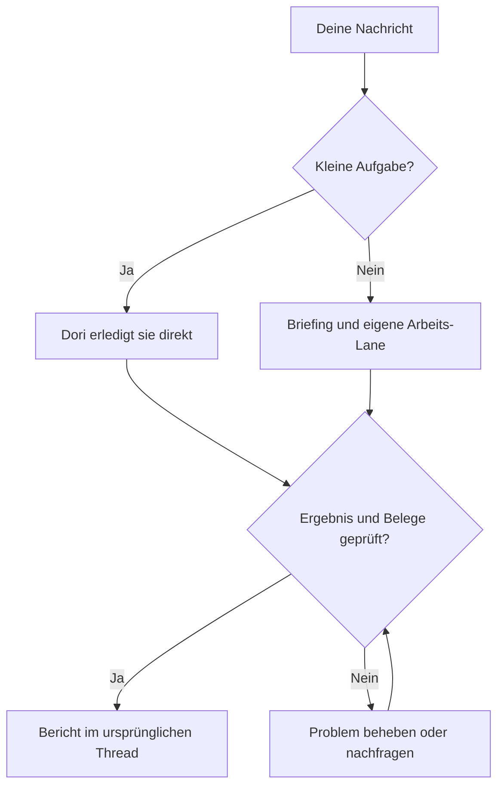

# omp-dori

Ein Dori, der die Philosophien dreier Projekte vereint:

1. [dori-superagent](https://github.com/sisyphuslabs/dori-superagent) — klare Aufgabenverantwortung im Messenger und Koordination anhand von Belegen.
2. [oh-my-pi](https://github.com/can1357/oh-my-pi) — die native OMP-Laufzeit und Werkzeuge für Coding-Agents.
3. [omp-ulw](https://github.com/dbc-hbin/omp-ulw) — disziplinierte, auf Ergebnisse ausgerichtete Arbeitsabläufe.

omp-dori ist eine angepasste Portierung auf OMP, die aus Messenger-Anfragen Arbeits-Lanes für Coding-Agents mit klarer Zuständigkeit macht und den Abschluss mit Belegen zurückmeldet.

[English](README.md) | [한국어](README.ko.md) | [日本語](README.ja.md) | [Deutsch](README.de.md) | [Italiano](README.it.md) | [中文](README.zh.md)

## Funktionen

- Gibt längeren Aufgaben ein eigenes Briefing, eine Agent-Session und eine erfasste Lane; kleine Anfragen erledigt der Lead direkt.
- Hält die Unterhaltung bei einer Stimme: Lanes berichten dem Lead, der im Thread der Anfrage antwortet.
- Prüft vor der Zustellung die aktuelle Identität des Agenten sowie Eingabe- und Freigabestatus; hält Nachrichten zurück oder reiht sie ein, wenn eine Session beschäftigt oder ihr Zustand unbekannt ist.
- Verlangt Abschlussbelege und prüft aktuelle Erledigt-Signale, etwa gemergte PRs, veröffentlichte Versionen, erfolgreiche Befehle oder übereinstimmende Dateien.
- Speichert Arbeitsprotokolle, Lane-Checkpoints und Registries auf der Festplatte, damit `dori boot` sie nach einem Neustart prüfen kann.
- Bewahrt Lektionen und ein Backlog; optionale stündliche Planung und die Überwachung von Host und stockenden Aufgaben unterstützen laufende Arbeit.

## Von der Anfrage zum Ergebnis



## Unterstützte Vorschau

**`v0.1.2` ist ein GitHub-Prerelease für Linux x64 + herdr + Discord.** Bun **1.4.4** und natives OMP **18.18.8** sind die getestete Basis und zugleich die Mindestversionen. Neuere Versionen und andere Linux-Distributionen sind nicht automatisch geprüft.

macOS und hc haben CI-Abdeckung und Adapter auf Source-`main`; ihr Live-Betrieb gehört nicht zur unterstützten Endnutzer-Vorschau. Slack und Telegram bleiben Funktionen des Quellcodes. Daraus folgt weder eine unabhängige Beta mit externen Nutzern noch eine Prüfung aller Provider und Oberflächen.

## Erste Schritte

### 1. Voraussetzungen und Versionen prüfen

Führe die folgenden Befehle in Bash auf Linux x64 aus (`uname` sollte `Linux` und `x86_64` melden). Stelle git, [Bun](https://bun.sh) **1.4.4+**, [natives OMP](https://github.com/can1357/oh-my-pi) **18.18.8+** und [herdr](https://github.com/herdrdev/herdr) anhand ihrer eigenen Installationsanleitungen über `PATH` bereit. Bash, curl, tar und `sha256sum` werden ebenfalls benötigt. Der Dori-Installer prüft die Werkzeuge; er installiert oder aktualisiert sie niemals.

```bash
uname -s
uname -m
for tool in bash curl tar sha256sum git bun omp herdr; do
  command -v "$tool" || exit 1
done
git --version
bun --version
omp --version
```

### 2. v0.1.2 herunterladen, prüfen und installieren

Prüfe vor dem Download Besitzer, Tag und Release-Commit im [kanonischen Release v0.1.2](https://github.com/vntrevx/omp-dori/releases/tag/v0.1.2). Folge der [geprüften Anleitung für das exakte Release](docs/releases.md#install-the-exact-preview) und lade alle vier Assets; ersetze sie nicht durch einen Fork, einen Installer von `main` oder einen Mirror. Verwende für die Erstinstallation dein eigenes Home-Verzeichnis ohne laufenden Dori. Prüfe eine vorhandene Installation, bevor du deren Quellcode oder Zustand änderst.

```bash
download_dir="$(mktemp -d)" || exit 1
cd "$download_dir" || exit 1
release_url="https://github.com/vntrevx/omp-dori/releases/download/v0.1.2"
for asset in install.sh release-manifest.json SHA256SUMS omp-dori-v0.1.2.tar.gz; do
  curl --proto '=https' --tlsv1.2 -fL "$release_url/$asset" -o "$asset" || exit 1
done
sha256sum --check SHA256SUMS || exit 1
bash ./install.sh --version v0.1.2 --from "$download_dir" || exit 1
"$HOME/.dori/bin/dori" --version
export PATH="$HOME/.dori/bin:$PATH"
```

Führe den Installer erst aus, wenn jede Prüfsumme stimmt. Prüfsummen belegen die Übereinstimmung mit dem vertrauenswürdigen Release, keine unabhängige Signatur; der Installer prüft zusätzlich Manifest, Archiv und die festgelegte öffentliche omp-ulw-Abhängigkeit. Auch mit `--from` kann die Erstinstallation anonymen git-Netzwerkzugriff für genau diese Abhängigkeit benötigen. Der explizite Launcher ist `~/.dori/bin/dori`; übernimm den PATH-Export bei Bedarf in deine Shell-Konfiguration. GitHub CLI und GitHub-Schreibrechte sind nicht erforderlich.

Die Installation startet **nichts**: keinen Agenten, Empfänger, Watcher, Präsenzprozess, Dienst oder Harness und keine Inferenzanfrage. Die Wiederaufnahme einer bestehenden Dori-Session kann ihre gespeicherten Monitore wiederherstellen; eine Neuinstallation legt keine an.

### 3. Deine eigene Umgebung konfigurieren

Folge der Anleitung zu [Authentifizierung und ausdrücklichem Start](docs/releases.md#your-authentication-and-explicit-startup). Installiere herdrs OMP-Integration ausdrücklich:

```bash
herdr integration install omp
```

Öffne ein herdr-Terminal im gewünschten Projektverzeichnis außerhalb des temporären Download-Verzeichnisses und ermittle dessen Pane-ID:

```bash
herdr pane current
```

Bearbeite `~/.dori/config.json`: Setze `runtime: "herdr"`, `leadPane` auf diese Pane-ID, `laneWorkspace`, `defaultCwd`, ein für dein Konto verfügbares `defaultModel` mit Provider-Angabe und Messenger-Hooks. Behalte `agentCommand`, `sessionsDir` und `ompUlwPath` des Installers bei. Vorhandene Konfiguration, Authentifizierung, Arbeit und Sessions bleiben erhalten. Authentifiziere OMP nach dessen Anleitung mit deinem eigenen Provider-Konto; Dori liefert keine Provider-Zugangsdaten mit.

Erstelle deinen eigenen Bot im [Discord Developer Portal](https://discord.com/developers/applications) und lade ihn ein. Erteile View Channel und Read Message History sowie Send Messages und die benötigten Thread-Rechte; aktiviere **Message Content Intent** auf der Bot-Seite. Die [Bot-Setup-Referenz](skills/dori-mode/references/setup.md#3-bot) beschreibt Rechte und Messenger-Hooks. Bewahre ausschließlich das Token in der regulären Datei `~/.dori/discord-token` auf, die dir gehört und Modus `0600` hat, gemäß der [Anleitung für die geschützte Token-Datei](docs/releases.md#your-authentication-and-explicit-startup). Nur der ausdrücklich aktivierte Monitor-Kindprozess liest es als `DORI_DISCORD_TOKEN`; halte den Wert aus Chat, Quellcode, Befehlsargumenten und der übergeordneten OMP-Umgebung heraus.

### 4. Die erste OMP-Rolle ausdrücklich starten

Aktiviere Discord Developer Mode und kopiere deine eigene Benutzer-ID und die genaue Kanal-ID beziehungsweise die ID des Threads selbst. Dies sind nicht geheime positive Dezimalzeichenfolgen. Verwende im selben herdr-Terminal die interaktiven Bash-Abfragen:

```bash
read -r -p "Your Discord user ID: " DORI_DISCORD_OWNER_ID
read -r -p "Discord channel or thread ID: " DORI_DISCORD_CHANNEL_ID
export DORI_DISCORD_OWNER_ID DORI_DISCORD_CHANNEL_ID
omp --dori-role dori
```

Sage dann „Dori mode“ und schließe das Onboarding für Name, Messenger-Ziel und erlaubte Werkzeuge ab. Dieser Schritt startet ausdrücklich eine KI-Session und verbraucht das Kontingent deines eigenen Providers.

### 5. Discord-Monitore gezielt aktivieren

Starte in der besitzenden OMP-Session ausdrücklich den nativen `monitor` mit dem Kindprozess-`argv`, das die geschützte Token-Datei liest, und dem Filter `^INBOUND` aus der [Anleitung für Discord-Besitzernachrichten](docs/releases.md#discord-owner-intake). Er erbt die beiden nicht geheimen IDs von oben. Warte auf `INBOUND_READY` und sende dann eine neue Nachricht als Besitzer; der erste Start speichert einen Ausgangspunkt, ohne alte Nachrichten erneut abzuspielen. Die [Online-Präsenz](docs/releases.md#discord-online-presence) benötigt einen eigenen, separat aktivierten nativen Monitor. Die Installation allein belegt weder Provider-Authentifizierung noch Messenger-Zustellung.

### Updates und Rollback

Verwende `dori update check --version v0.1.2`, `dori update install --version v0.1.2`, `dori update status` und `dori update rollback`. Die Aktivierung wartet, solange eine Dori-Session läuft, auch wenn sie untätig ist; plane ein Wartungsfenster mit gestopptem Dori ein. Ein Rollback erfordert ein geprüftes, aufbewahrtes vorheriges Release. Siehe [Update-Optionen und Wiederherstellung](docs/releases.md#updates-and-rollback).

### Installation aus dem Quellcode neben einem bestehenden Dori

Maintainer verwenden einen separaten, gewöhnlichen Checkout und `scripts/install-source.sh` gemäß der [Anleitung zur Source-Installation](docs/releases.md#source-checkouts-for-maintainers). Der Side-Modus hat ein eigenes Home-Verzeichnis, eigene Wrapper und einen eigenen Skill; die primäre Dori-Installation bleibt unberührt. Von Endnutzer-Releases verwaltete Home-Verzeichnisse sind vor Source-Installationen geschützt. Lass installierte Endnutzer-Releases unverändert.

Dies ist ein optionaler Weg über Source-`main`, getrennt von der Endnutzer-Vorschau. Wenn das dokumentierte Zielverzeichnis noch unbenutzt ist:

```bash
git clone https://github.com/vntrevx/omp-dori.git "$HOME/src/omp-dori" || exit 1
cd "$HOME/src/omp-dori" || exit 1
DORI_INSTALL_MODE=side DORI_NO_PULL=1 DORI_SRC="$PWD" bash scripts/install-source.sh
```

`DORI_NO_PULL=1` installiert den gewählten Checkout unverändert. Der Side-Modus verwendet standardmäßig `~/.omp-dori/config.json` sowie eigene Zustandsdaten und Wrapper; nur `omp-dori` wird in `OMP_DORI_BIN_DIR` verlinkt (Standard `${BUN_INSTALL:-$HOME/.bun}/bin`). Verwende für dieses Home `omp-dori <command>` und `omp-dori omp ...`, behalte die erzeugten Werte für `stateDir` und `agentCommand` bei und nutze einen separaten Bot/Kanal und Laufzeit-Namensraum. Diese optionale Installation startet keine Sessions oder Monitore und lässt das primäre `~/.dori`, den Befehl `dori` und globale Skill-/Extension-Links unverändert.

Das installierte `dori` ist die Messenger-/Lane-CLI. Der vollständige Harness bleibt über `dori harness <args>` oder `bun src/cli.ts <args>` aus einem Source-Checkout verfügbar. Der Harness-Start erzeugt echte Sessions und Loops; seine Registry und sein Abschlussprotokoll sind von denen des Skills getrennt. Maintainer aktualisieren den Quellcode mit [`dori upstream`](skills/dori-mode/references/scripts.md#staged-dori-updates), getrennt von Updates der Endnutzer-Releases.

## OMP session contract

Lead-/Duty-Sessions verwenden `omp --dori-role dori`; Arbeits-Lanes und der eingebaute Reviewer verwenden `--dori-role lane`. Doris Erweiterungs-Handler werden rollenabhängig aktiviert; gewöhnliche OMP-Sessions bleiben unverändert. Rollen bleiben bei der Wiederaufnahme erhalten, und prozessgebundene native Session- und Freigabeeinträge sichern die Eingabezustellung ab. Native Ziele und gespeicherte Monitor-Startabsichten bleiben im Session-Zustand erhalten; die Wiederaufnahme der besitzenden Dori-Session stellt ihre gespeicherten Monitore wieder her. Endnutzer-Releases behalten den an ihr Manifest gebundenen omp-ulw-Stand und den rollenbegrenzten Import bei. Bei Source-Installationen kann der Primary-Modus omp-ulw global laden, während der Side-Modus es auf seinen Wrapper begrenzt. Siehe den [Laufzeitvertrag](docs/runtime.md).

## Dokumentation

- [Releases, Installation, Support, Updates und Rollback](docs/releases.md)
- [Dori-Skill und Betriebsregeln](skills/dori-mode/SKILL.md) · [Setup-Referenz](skills/dori-mode/references/setup.md)
- [Laufzeitadapter und Session-Verträge](docs/runtime.md)
- [Container-Anleitung für Maintainer](docs/container.md) · [Stündlicher Loop und Backlog](docs/hourly-loop.md)
- [Mitwirken](CONTRIBUTING.md) · [Änderungsprotokoll](CHANGELOG.md) · [Hinweis zur modifizierten Kopie](NOTICE)

## Mitwirken

Erstelle [Issues](https://github.com/vntrevx/omp-dori/issues) und [Pull Requests](https://github.com/vntrevx/omp-dori/pulls) für omp-dori in diesem Fork. Beachte die [Hinweise zum Mitwirken](CONTRIBUTING.md); das CLA-Verfahren von Upstream ist davon getrennt.

## Grenzen und Datenschutz

Dori nutzt die Konten und Berechtigungen, die du bereitstellst. Externe Aktionen brauchen weiterhin die Freigabe des Besitzers; Abschlussprüfungen belegen die konfigurierten Signale, nicht die Richtigkeit jedes Ergebnisses. Aktiviere nur die Sessions und Monitore, die du ausführen willst. KI-Sessions verbrauchen das Kontingent deines eigenen Providers.

Die optionale Telemetrie lässt sich mit `DORI_TELEMETRY=0` oder `DO_NOT_TRACK=1` abschalten. Halte Zugangsdaten und private Session-/Projektdaten aus öffentlichen Berichten heraus.

## Lizenz

Upstream-Code bleibt unter der [Sustainable Use License 1.0](LICENSE): eigener interner Geschäftsgebrauch sowie nicht kommerzielle/private Nutzung, unter Einhaltung der Bedingungen zu Weitergabe und Hinweisen. Der bestehende Hinweis zur OMP-Integration bleibt in [LICENSE.omp-dori (MIT)](LICENSE.omp-dori); dadurch erhält Upstream-Code keine MIT-Lizenz. [NOTICE](NOTICE) dokumentiert die modifizierte Kopie und die Urheberangaben. omp-ulw und andere Drittkomponenten behalten ihre eigenen Lizenzen.
