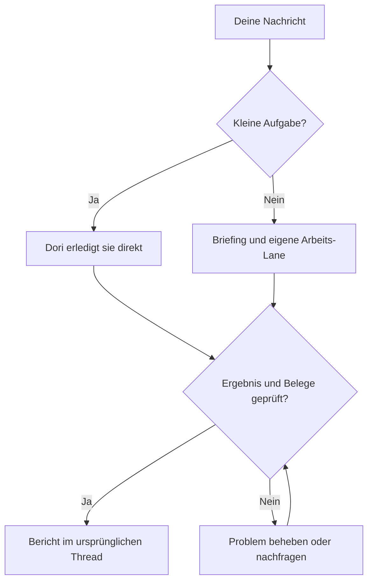

# omp-dori

Ein Dori, der die Philosophien dreier Projekte vereint:

1. [dori-superagent](https://github.com/sisyphuslabs/dori-superagent) — klare Aufgabenverantwortung im Messenger und Koordination anhand von Belegen.
2. [oh-my-pi](https://github.com/can1357/oh-my-pi) — die native OMP-Laufzeit und Werkzeuge für Coding-Agents.
3. [omp-ulw](https://github.com/dbc-hbin/omp-ulw) — disziplinierte, auf Ergebnisse ausgerichtete Arbeitsabläufe.

omp-dori ist eine angepasste Portierung auf OMP, die aus Messenger-Anfragen Arbeits-Lanes für Coding-Agents mit klarer Zuständigkeit macht und den Abschluss mit Belegen zurückmeldet.

[English](README.md) | [한국어](README.ko.md) | [日本語](README.ja.md) | [Deutsch](README.de.md) | [Italiano](README.it.md) | [中文](README.zh.md)

## Funktionen

- Gibt längeren Aufgaben ein eigenes Briefing, eine Agent-Session und eine erfasste Lane; kleine Anfragen erledigt der Lead direkt.
- Hält die Unterhaltung bei einer Stimme: Lanes berichten dem Lead, der im Thread der Anfrage antwortet.
- Prüft vor der Zustellung die aktuelle Identität des Agenten sowie Eingabe- und Freigabestatus; hält Nachrichten zurück oder reiht sie ein, wenn eine Session beschäftigt oder ihr Zustand unbekannt ist.
- Verlangt Abschlussbelege und prüft aktuelle Erledigt-Signale, etwa gemergte PRs, veröffentlichte Versionen, erfolgreiche Befehle oder übereinstimmende Dateien.
- Speichert Arbeitsprotokolle, Lane-Checkpoints und Registries auf der Festplatte, damit `dori boot` sie nach einem Neustart prüfen kann.
- Bewahrt Lektionen und ein Backlog; optionale stündliche Planung und die Überwachung von Host und stockenden Aufgaben unterstützen laufende Arbeit.

## Von der Anfrage zum Ergebnis

## Unterstützte Vorschau

**`v0.1.2` ist ein GitHub-Prerelease für Linux x64 + herdr + Discord.** Bun **1.4.4** und natives OMP **18.18.8** sind die getestete Basis und zugleich die Mindestversionen. Neuere Versionen und andere Linux-Distributionen sind nicht automatisch geprüft.

macOS und hc haben CI-Abdeckung und weiterhin Adapter im Quellcode; ihr Live-Betrieb gehört nicht zur unterstützten Endnutzer-Vorschau. Slack und Telegram bleiben Funktionen des Quellcodes. Daraus folgt weder eine unabhängige Beta mit externen Nutzern noch eine Prüfung aller Provider und Oberflächen.

## Erste Schritte

1. Stelle git, Bun 1.4.4+, natives OMP 18.18.8+ und herdr über `PATH` bereit. Der Installer prüft diese Werkzeuge; er installiert oder aktualisiert sie niemals.
2. Folge der [geprüften Anleitung für das exakte Release](docs/releases.md#install-the-exact-preview). Prüfe das kanonische Repository samt Tag und alle vier Assets, bevor du den heruntergeladenen Installer ausdrücklich mit `--version v0.1.2` ausführst. Der Launcher ist `~/.dori/bin/dori`; füge `~/.dori/bin` zu `PATH` hinzu.
3. Richte deine eigene `~/.dori/config.json` mit `runtime: "herdr"`, Workspace-Pfaden, einem Modell mit expliziter Provider-Angabe und Messenger-Hooks ein. Vorhandene Konfiguration, Authentifizierung, Arbeit und Sessions bleiben erhalten. Verwende dein eigenes OMP-Provider-Konto und deinen eigenen Discord-Bot.
4. Folge der Anleitung zu [Authentifizierung und ausdrücklichem Start](docs/releases.md#your-authentication-and-explicit-startup): Installiere herdrs OMP-Integration, richte Kanalberechtigungen und Message Content Intent des Bots ein, setze die Besitzer- und Kanal-IDs, starte dann `omp --dori-role dori` in herdr und sage „Dori mode“.
5. Aktiviere ausdrücklich den nativen Monitor für den [Empfang von Discord-Besitzernachrichten](docs/releases.md#discord-owner-intake). Bewahre das Token in einer Datei auf, die dir gehört und Modus 0600 hat, und lies es nur im Kindprozess des Monitors. Warte auf `INBOUND_READY` und sende dann eine neue Nachricht als Besitzer. Die [Online-Präsenz](docs/releases.md#discord-online-presence) benötigt einen eigenen, separat aktivierten Monitor.

Die Installation startet **nichts**: keinen Agenten, Empfänger, Watcher, Präsenzprozess, Dienst oder Harness und keine Inferenzanfrage. Die Wiederaufnahme einer bestehenden Dori-Session kann ihre gespeicherten Monitore wiederherstellen; eine Neuinstallation legt keine an.

### Updates und Rollback

Verwende `dori update check --version v0.1.2`, `dori update install --version v0.1.2`, `dori update status` und `dori update rollback`. Die Aktivierung wartet, solange eine Dori-Session läuft, auch wenn sie untätig ist; plane ein Wartungsfenster mit gestopptem Dori ein. Ein Rollback erfordert ein geprüftes, aufbewahrtes vorheriges Release. Siehe [Update-Optionen und Wiederherstellung](docs/releases.md#updates-and-rollback).

### Installation aus dem Quellcode neben einem bestehenden Dori

Maintainer verwenden einen separaten, gewöhnlichen Checkout und `scripts/install-source.sh` gemäß der [Anleitung zur Source-Installation](docs/releases.md#source-checkouts-for-maintainers). Der Side-Modus hat ein eigenes Home-Verzeichnis, eigene Wrapper und einen eigenen Skill; die primäre Dori-Installation bleibt unberührt. Von Endnutzer-Releases verwaltete Home-Verzeichnisse sind vor Source-Installationen geschützt. Lass installierte Endnutzer-Releases unverändert.

Das installierte `dori` ist die Messenger-/Lane-CLI. Der vollständige Harness bleibt über `dori harness <args>` oder `bun src/cli.ts <args>` aus einem Source-Checkout verfügbar. Der Harness-Start erzeugt echte Sessions und Loops; seine Registry und sein Abschlussprotokoll sind von denen des Skills getrennt. Maintainer aktualisieren den Quellcode mit [`dori upstream`](skills/dori-mode/references/scripts.md#staged-dori-updates), getrennt von Updates der Endnutzer-Releases.

## OMP session contract

Lead-/Duty-Sessions verwenden `omp --dori-role dori`; Arbeits-Lanes und der eingebaute Reviewer verwenden `--dori-role lane`. Doris Erweiterungs-Handler werden rollenabhängig aktiviert; gewöhnliche OMP-Sessions bleiben unverändert. Rollen bleiben bei der Wiederaufnahme erhalten, und prozessgebundene native Session- und Freigabeeinträge sichern die Eingabezustellung ab. Native Ziele und gespeicherte Monitor-Startabsichten bleiben im Session-Zustand erhalten; die Wiederaufnahme der besitzenden Dori-Session stellt ihre gespeicherten Monitore wieder her. Endnutzer-Releases behalten den an ihr Manifest gebundenen omp-ulw-Stand und den rollenbegrenzten Import bei. Bei Source-Installationen kann der Primary-Modus omp-ulw global laden, während der Side-Modus es auf seinen Wrapper begrenzt. Siehe den [Laufzeitvertrag](docs/runtime.md).

## Dokumentation

- [Releases, Installation, Support, Updates und Rollback](docs/releases.md)
- [Dori-Skill und Betriebsregeln](skills/dori-mode/SKILL.md) · [Setup-Referenz](skills/dori-mode/references/setup.md)
- [Laufzeitadapter und Session-Verträge](docs/runtime.md)
- [Container-Anleitung für Maintainer](docs/container.md) · [Stündlicher Loop und Backlog](docs/hourly-loop.md)
- [Mitwirken](CONTRIBUTING.md) · [Änderungsprotokoll](CHANGELOG.md) · [Hinweis zur modifizierten Kopie](NOTICE)

## Mitwirken

Erstelle [Issues](https://github.com/vntrevx/omp-dori/issues) und [Pull Requests](https://github.com/vntrevx/omp-dori/pulls) für omp-dori in diesem Fork. Beachte die [Hinweise zum Mitwirken](CONTRIBUTING.md); das CLA-Verfahren von Upstream ist davon getrennt.

## Grenzen und Datenschutz

Dori nutzt die Konten und Berechtigungen, die du bereitstellst. Externe Aktionen brauchen weiterhin die Freigabe des Besitzers; Abschlussprüfungen belegen die konfigurierten Signale, nicht die Richtigkeit jedes Ergebnisses. Aktiviere nur die Sessions und Monitore, die du ausführen willst. KI-Sessions verbrauchen das Kontingent deines eigenen Providers.

Die optionale Telemetrie lässt sich mit `DORI_TELEMETRY=0` oder `DO_NOT_TRACK=1` abschalten. Halte Zugangsdaten und private Session-/Projektdaten aus öffentlichen Berichten heraus.

## Lizenz

Upstream-Code bleibt unter der [Sustainable Use License 1.0](LICENSE): eigener interner Geschäftsgebrauch sowie nicht kommerzielle/private Nutzung, unter Einhaltung der Bedingungen zu Weitergabe und Hinweisen. Der bestehende Hinweis zur OMP-Integration bleibt in [LICENSE.omp-dori (MIT)](LICENSE.omp-dori); dadurch erhält Upstream-Code keine MIT-Lizenz. [NOTICE](NOTICE) dokumentiert die modifizierte Kopie und die Urheberangaben. omp-ulw und andere Drittkomponenten behalten ihre eigenen Lizenzen.
