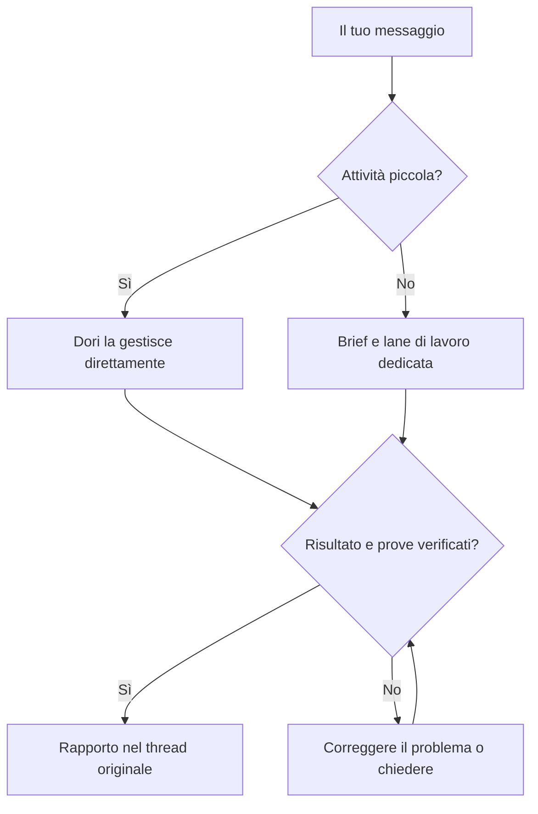

# omp-dori

Un solo Dori, che unisce le filosofie di tre progetti:

1. [dori-superagent](https://github.com/sisyphuslabs/dori-superagent) — presa in carico del lavoro via chat e coordinamento basato su prove.
2. [oh-my-pi](https://github.com/can1357/oh-my-pi) — runtime nativo OMP e strumenti per coding agent.
3. [omp-ulw](https://github.com/dbc-hbin/omp-ulw) — flussi di lavoro rigorosi e orientati ai risultati.

omp-dori è un port modificato per OMP che trasforma le richieste via chat in lane di lavoro affidate a coding agent e risponde con prove del completamento.

[English](README.md) | [한국어](README.ko.md) | [日本語](README.ja.md) | [Deutsch](README.de.md) | [Italiano](README.it.md) | [中文](README.zh.md)

## Cosa fa

- Assegna alle attività più lunghe un brief, una sessione agente e una lane tracciata; il lead gestisce direttamente le piccole richieste.
- Mantiene una sola voce nella conversazione: le lane fanno rapporto al lead, che risponde nel thread della richiesta.
- Verifica l'identità attuale dell'agente, lo stato dell'input e delle approvazioni prima della consegna; trattiene o accoda i messaggi quando una sessione è occupata o il suo stato è sconosciuto.
- Richiede prove del completamento e verifica i segnali di conclusione correnti, come PR integrate, versioni pubblicate, comandi riusciti o file corrispondenti.
- Salva worklog, checkpoint delle lane e registri su disco, così `dori boot` può esaminarli dopo un riavvio.
- Conserva lezioni e backlog e offre pianificazione oraria facoltativa e supervisione dell'host e delle attività in stallo per il lavoro continuativo.

## Dalla richiesta al risultato



## Anteprima supportata

**`v0.1.2` è una prerelease GitHub per Linux x64 + herdr + Discord.** Bun **1.4.4** e OMP nativo **18.18.8** sono la base testata e le versioni minime. Versioni più recenti e altre distribuzioni Linux non sono automaticamente verificate.

macOS e hc hanno copertura CI e adattatori nel `main` del sorgente; non rientrano nell'anteprima supportata per l'uso reale da parte degli utenti. Slack e Telegram restano funzionalità del sorgente. Questo ambito non implica una beta indipendente con utenti esterni né che ogni provider e interfaccia sia stato testato.

## Per iniziare

### 1. Verificare prerequisiti e versioni

Esegui i comandi seguenti in Bash su Linux x64 (`uname` deve indicare `Linux` e `x86_64`). Rendi disponibili git, [Bun](https://bun.sh) **1.4.4+**, [OMP nativo](https://github.com/can1357/oh-my-pi) **18.18.8+** e [herdr](https://github.com/herdrdev/herdr) nel `PATH` seguendo le rispettive istruzioni di installazione. Servono anche Bash, curl, tar e `sha256sum`. L'installer di Dori verifica gli strumenti; non li installa né li aggiorna mai.

```bash
uname -s
uname -m
for tool in bash curl tar sha256sum git bun omp herdr; do
  command -v "$tool" || exit 1
done
git --version
bun --version
omp --version
```

### 2. Scaricare, verificare e installare v0.1.2

Prima del download verifica proprietario del repository, tag e commit della [release canonica v0.1.2](https://github.com/vntrevx/omp-dori/releases/tag/v0.1.2). Segui la [guida verificata alla release esatta](docs/releases.md#install-the-exact-preview) e scarica tutti e quattro gli asset; non sostituirli con un fork, un installer di `main` o un mirror. Per la prima installazione usa la tua home senza Dori in esecuzione. Esamina un'installazione esistente prima di modificarne sorgente o stato.

```bash
download_dir="$(mktemp -d)" || exit 1
cd "$download_dir" || exit 1
release_url="https://github.com/vntrevx/omp-dori/releases/download/v0.1.2"
for asset in install.sh release-manifest.json SHA256SUMS omp-dori-v0.1.2.tar.gz; do
  curl --proto '=https' --tlsv1.2 -fL "$release_url/$asset" -o "$asset" || exit 1
done
sha256sum --check SHA256SUMS || exit 1
bash ./install.sh --version v0.1.2 --from "$download_dir" || exit 1
"$HOME/.dori/bin/dori" --version
export PATH="$HOME/.dori/bin:$PATH"
```

Esegui l'installer solo dopo che tutti i checksum sono corretti. I checksum dimostrano la corrispondenza con la release attendibile, non sono una firma indipendente; l'installer verifica anche manifest, archivio e dipendenza pubblica omp-ulw fissata. Anche con `--from`, la prima installazione può richiedere accesso git anonimo alla rete per quella dipendenza esatta. Il launcher esplicito è `~/.dori/bin/dori`; conserva l'export del PATH nella configurazione della tua shell, se desideri. Non servono GitHub CLI o permessi di scrittura su GitHub.

L'installazione non avvia **nulla**: nessun agente, ricevitore, watcher, processo di presenza, servizio, harness o richiesta di inferenza. Riprendere una sessione Dori esistente può ripristinarne i monitor registrati; una nuova installazione non ne crea.

### 3. Configurare il proprio ambiente

Segui la guida ad [autenticazione e avvio esplicito](docs/releases.md#your-authentication-and-explicit-startup). Installa esplicitamente l'integrazione OMP di herdr:

```bash
herdr integration install omp
```

Apri un terminale herdr nella directory del progetto in cui vuoi lavorare, fuori dalla directory temporanea di download, e ricava il suo ID pane:

```bash
herdr pane current
```

Modifica `~/.dori/config.json`: imposta `runtime: "herdr"`, `leadPane` con quell'ID pane, `laneWorkspace`, `defaultCwd`, un `defaultModel` qualificato con il provider e disponibile al tuo account, e gli hook di messaggistica. Mantieni `agentCommand`, `sessionsDir` e `ompUlwPath` dell'installer. Configurazione, autenticazione, lavoro e sessioni esistenti vengono conservati. Autentica OMP con il tuo account provider seguendo le istruzioni di OMP; Dori non include credenziali del provider.

Crea e invita il tuo bot tramite il [Discord Developer Portal](https://discord.com/developers/applications). Concedi View Channel e Read Message History, oltre a Send Messages e ai permessi per i thread che userai; abilita **Message Content Intent** nella pagina Bot. Il [riferimento per la configurazione del bot](skills/dori-mode/references/setup.md#3-bot) descrive permessi e hook di messaggistica. Conserva soltanto il token in un file regolare di tua proprietà `~/.dori/discord-token` con modalità `0600`, seguendo le [istruzioni per il file token protetto](docs/releases.md#your-authentication-and-explicit-startup). Solo il processo figlio del monitor abilitato esplicitamente lo legge come `DORI_DISCORD_TOKEN`; tieni il valore fuori da chat, sorgenti, argomenti dei comandi e ambiente OMP padre.

### 4. Avviare esplicitamente il primo ruolo OMP

Abilita Discord Developer Mode e copia il tuo ID utente e l'ID esatto del canale, oppure l'ID del thread stesso. Sono stringhe decimali positive non segrete. Nello stesso terminale herdr usa le richieste interattive di Bash:

```bash
read -r -p "Your Discord user ID: " DORI_DISCORD_OWNER_ID
read -r -p "Discord channel or thread ID: " DORI_DISCORD_CHANNEL_ID
export DORI_DISCORD_OWNER_ID DORI_DISCORD_CHANNEL_ID
omp --dori-role dori
```

Poi di' «Dori mode» e completa l'onboarding per nome, destinazione dei messaggi e strumenti consentiti. Questo passaggio avvia esplicitamente una sessione AI e consuma la quota del tuo provider.

### 5. Abilitare i monitor Discord scelti

Nella sessione OMP proprietaria avvia esplicitamente il `monitor` nativo con l'`argv` del processo figlio che legge il file token protetto e il filtro `^INBOUND`, come nella [ricetta per la ricezione dei messaggi del proprietario su Discord](docs/releases.md#discord-owner-intake). Eredita i due ID non segreti impostati sopra. Attendi `INBOUND_READY`, poi invia un nuovo messaggio come proprietario; il primo avvio registra un punto iniziale senza riprodurre i vecchi messaggi. La [presenza online](docs/releases.md#discord-online-presence) richiede un proprio monitor nativo abilitato separatamente. La sola installazione non dimostra l'autenticazione del provider né la consegna dei messaggi.

### Aggiornamenti e rollback

Usa `dori update check --version v0.1.2`, `dori update install --version v0.1.2`, `dori update status` e `dori update rollback`. L'attivazione resta in attesa finché esiste una sessione Dori in esecuzione, anche se non sta lavorando; pianifica un intervallo di manutenzione con Dori fermo. Il rollback richiede una release precedente conservata e verificata. Vedi [opzioni di aggiornamento e ripristino](docs/releases.md#updates-and-rollback).

### Installazione da sorgente accanto a un Dori esistente

I maintainer usano un checkout ordinario separato e `scripts/install-source.sh`, seguendo la [guida all'installazione da sorgente](docs/releases.md#source-checkouts-for-maintainers). La modalità side usa home, wrapper e skill propri e lascia intatta l'installazione Dori primaria. Le home gestite dalle release per gli utenti sono protette dall'installazione da sorgente. Mantieni immutate le release utente installate.

Questo è un percorso facoltativo dal `main` del sorgente, separato dall'anteprima per gli utenti. Eseguilo se la destinazione documentata del checkout è ancora inutilizzata:

```bash
git clone https://github.com/vntrevx/omp-dori.git "$HOME/src/omp-dori" || exit 1
cd "$HOME/src/omp-dori" || exit 1
DORI_INSTALL_MODE=side DORI_NO_PULL=1 DORI_SRC="$PWD" bash scripts/install-source.sh
```

`DORI_NO_PULL=1` installa il checkout selezionato così com'è. La modalità side usa per impostazione predefinita `~/.omp-dori/config.json` e stato e wrapper propri; collega solo `omp-dori` in `OMP_DORI_BIN_DIR` (predefinito `${BUN_INSTALL:-$HOME/.bun}/bin`). Usa `omp-dori <command>` e `omp-dori omp ...` per quella home, mantieni `stateDir` e `agentCommand` generati e usa bot, canale e namespace runtime separati. Questa installazione facoltativa non avvia sessioni o monitor e lascia intatti il `~/.dori` primario, il comando `dori` e i collegamenti globali di skill ed estensioni.

Il `dori` installato è la CLI di messaggistica e gestione delle lane. L'harness completo resta disponibile tramite `dori harness <args>` o `bun src/cli.ts <args>` da un checkout sorgente. L'avvio dell'harness crea sessioni e loop reali; il suo registro e il suo protocollo di completamento sono separati da quelli della skill. I maintainer aggiornano il sorgente con [`dori upstream`](skills/dori-mode/references/scripts.md#staged-dori-updates), separatamente dagli aggiornamenti delle release per gli utenti.

## OMP session contract

Le sessioni lead/duty usano `omp --dori-role dori`; le lane di lavoro e il revisore integrato usano `--dori-role lane`. Gli handler dell'estensione Dori si attivano in base al ruolo, lasciando invariate le normali sessioni OMP. I ruoli persistono alla ripresa, e i record nativi di sessione e approvazione, associati al processo, proteggono la consegna degli input. Gli obiettivi nativi e le intenzioni registrate per i monitor persistono nello stato della sessione; riprendere la sessione Dori che li possiede ne ripristina i monitor registrati. Le release per gli utenti mantengono la revisione di omp-ulw vincolata al manifest e l'importazione limitata ai ruoli. La modalità primary delle installazioni da sorgente può caricare omp-ulw globalmente, mentre la modalità side lo limita al proprio wrapper. Vedi il [contratto del runtime](docs/runtime.md).

## Documentazione

- [Release, installazione, supporto, aggiornamenti e rollback](docs/releases.md)
- [Skill Dori e regole operative](skills/dori-mode/SKILL.md) · [Riferimento per il setup](skills/dori-mode/references/setup.md)
- [Adattatori runtime e contratti delle sessioni](docs/runtime.md)
- [Ricetta container per maintainer](docs/container.md) · [Loop orario e backlog](docs/hourly-loop.md)
- [Contribuire](CONTRIBUTING.md) · [Registro delle modifiche](CHANGELOG.md) · [Avviso sulla copia modificata](NOTICE)

## Contribuire

Apri [issue](https://github.com/vntrevx/omp-dori/issues) e [pull request](https://github.com/vntrevx/omp-dori/pulls) per omp-dori in questo fork. Segui la [guida ai contributi](CONTRIBUTING.md); la procedura CLA upstream è separata.

## Limiti e privacy

Dori usa gli account e i permessi che fornisci. Le azioni esterne richiedono comunque l'autorizzazione del proprietario; i controlli di completamento dimostrano i segnali configurati, non la correttezza di ogni risultato. Abilita solo le sessioni e i monitor che intendi eseguire. Le sessioni AI consumano la quota del tuo provider.

La telemetria facoltativa si disattiva con `DORI_TELEMETRY=0` o `DO_NOT_TRACK=1`. Tieni credenziali e dati privati di sessioni e progetti fuori dai rapporti pubblici.

## Licenza

Il codice upstream resta sotto la [Sustainable Use License 1.0](LICENSE): uso interno della propria attività e uso non commerciale/personale, con condizioni per distribuzione e avvisi. L'avviso preesistente sull'integrazione OMP resta in [LICENSE.omp-dori (MIT)](LICENSE.omp-dori); questo non attribuisce la licenza MIT al codice upstream. [NOTICE](NOTICE) documenta la copia modificata e le attribuzioni. omp-ulw e gli altri componenti di terze parti mantengono le proprie licenze.
