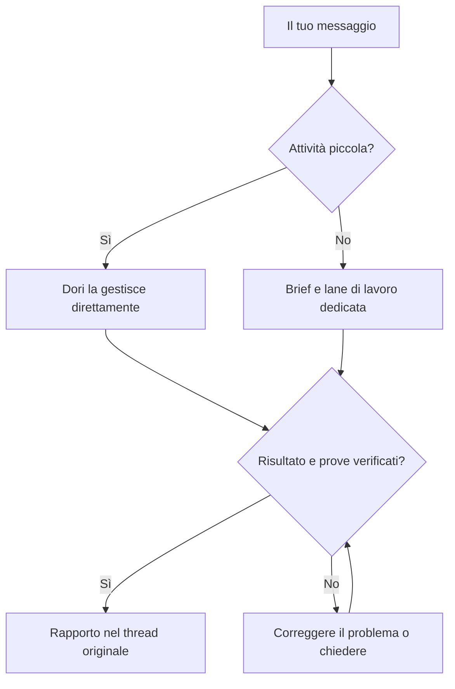

# omp-dori

Un solo Dori, che unisce le filosofie di tre progetti:

1. [dori-superagent](https://github.com/sisyphuslabs/dori-superagent) — presa in carico del lavoro via chat e coordinamento basato su prove.
2. [oh-my-pi](https://github.com/can1357/oh-my-pi) — runtime nativo OMP e strumenti per coding agent.
3. [omp-ulw](https://github.com/dbc-hbin/omp-ulw) — flussi di lavoro rigorosi e orientati ai risultati.

omp-dori è un port modificato per OMP che trasforma le richieste via chat in lane di lavoro affidate a coding agent e risponde con prove del completamento.

[English](README.md) | [한국어](README.ko.md) | [日本語](README.ja.md) | [Deutsch](README.de.md) | [Italiano](README.it.md) | [中文](README.zh.md)

## Cosa fa

- Assegna alle attività più lunghe un brief, una sessione agente e una lane tracciata; il lead gestisce direttamente le piccole richieste.
- Mantiene una sola voce nella conversazione: le lane fanno rapporto al lead, che risponde nel thread della richiesta.
- Verifica l'identità attuale dell'agente, lo stato dell'input e delle approvazioni prima della consegna; trattiene o accoda i messaggi quando una sessione è occupata o il suo stato è sconosciuto.
- Richiede prove del completamento e verifica i segnali di conclusione correnti, come PR integrate, versioni pubblicate, comandi riusciti o file corrispondenti.
- Salva worklog, checkpoint delle lane e registri su disco, così `dori boot` può esaminarli dopo un riavvio.
- Conserva lezioni e backlog e offre pianificazione oraria facoltativa e supervisione dell'host e delle attività in stallo per il lavoro continuativo.

## Dalla richiesta al risultato

## Anteprima supportata

**`v0.1.2` è una prerelease GitHub per Linux x64 + herdr + Discord.** Bun **1.4.4** e OMP nativo **18.18.8** sono la base testata e le versioni minime. Versioni più recenti e altre distribuzioni Linux non sono automaticamente verificate.

macOS e hc hanno copertura CI e mantengono adattatori nel codice sorgente; non rientrano nell'anteprima supportata per l'uso reale da parte degli utenti. Slack e Telegram restano funzionalità del sorgente. Questo ambito non implica una beta indipendente con utenti esterni né che ogni provider e interfaccia sia stato testato.

## Per iniziare

1. Rendi disponibili git, Bun 1.4.4+, OMP nativo 18.18.8+ e herdr nel `PATH`. L'installer verifica questi strumenti; non li installa né li aggiorna mai.
2. Segui la [guida verificata alla release esatta](docs/releases.md#install-the-exact-preview). Verifica il repository e il tag canonici e tutti e quattro gli asset prima di eseguire l'installer scaricato con `--version v0.1.2` esplicito. Il launcher è `~/.dori/bin/dori`; aggiungi `~/.dori/bin` al `PATH`.
3. Configura il tuo `~/.dori/config.json` con `runtime: "herdr"`, percorsi dei workspace, un modello qualificato con il provider e hook di messaggistica. Configurazione, autenticazione, lavoro e sessioni esistenti vengono conservati. Usa il tuo account provider OMP e il tuo bot Discord.
4. Segui la guida ad [autenticazione e avvio esplicito](docs/releases.md#your-authentication-and-explicit-startup): installa l'integrazione OMP di herdr, configura i permessi dei canali del bot e il Message Content Intent, imposta gli ID del proprietario e dei canali, poi avvia `omp --dori-role dori` in herdr e di' «Dori mode».
5. Abilita esplicitamente il monitor nativo per la [ricezione dei messaggi del proprietario su Discord](docs/releases.md#discord-owner-intake). Conserva il token in un file di tua proprietà con permessi 0600 e leggilo solo nel processo figlio del monitor. Attendi `INBOUND_READY`, poi invia un nuovo messaggio come proprietario. La [presenza online](docs/releases.md#discord-online-presence) richiede un proprio monitor, abilitato separatamente.

L'installazione non avvia **nulla**: nessun agente, ricevitore, watcher, processo di presenza, servizio, harness o richiesta di inferenza. Riprendere una sessione Dori esistente può ripristinarne i monitor registrati; una nuova installazione non ne crea.

### Aggiornamenti e rollback

Usa `dori update check --version v0.1.2`, `dori update install --version v0.1.2`, `dori update status` e `dori update rollback`. L'attivazione resta in attesa finché esiste una sessione Dori in esecuzione, anche se non sta lavorando; pianifica un intervallo di manutenzione con Dori fermo. Il rollback richiede una release precedente conservata e verificata. Vedi [opzioni di aggiornamento e ripristino](docs/releases.md#updates-and-rollback).

### Installazione da sorgente accanto a un Dori esistente

I maintainer usano un checkout ordinario separato e `scripts/install-source.sh`, seguendo la [guida all'installazione da sorgente](docs/releases.md#source-checkouts-for-maintainers). La modalità side usa home, wrapper e skill propri e lascia intatta l'installazione Dori primaria. Le home gestite dalle release per gli utenti sono protette dall'installazione da sorgente. Mantieni immutate le release utente installate.

Il `dori` installato è la CLI di messaggistica e gestione delle lane. L'harness completo resta disponibile tramite `dori harness <args>` o `bun src/cli.ts <args>` da un checkout sorgente. L'avvio dell'harness crea sessioni e loop reali; il suo registro e il suo protocollo di completamento sono separati da quelli della skill. I maintainer aggiornano il sorgente con [`dori upstream`](skills/dori-mode/references/scripts.md#staged-dori-updates), separatamente dagli aggiornamenti delle release per gli utenti.

## OMP session contract

Le sessioni lead/duty usano `omp --dori-role dori`; le lane di lavoro e il revisore integrato usano `--dori-role lane`. Gli handler dell'estensione Dori si attivano in base al ruolo, lasciando invariate le normali sessioni OMP. I ruoli persistono alla ripresa, e i record nativi di sessione e approvazione, associati al processo, proteggono la consegna degli input. Gli obiettivi nativi e le intenzioni registrate per i monitor persistono nello stato della sessione; riprendere la sessione Dori che li possiede ne ripristina i monitor registrati. Le release per gli utenti mantengono la revisione di omp-ulw vincolata al manifest e l'importazione limitata ai ruoli. La modalità primary delle installazioni da sorgente può caricare omp-ulw globalmente, mentre la modalità side lo limita al proprio wrapper. Vedi il [contratto del runtime](docs/runtime.md).

## Documentazione

- [Release, installazione, supporto, aggiornamenti e rollback](docs/releases.md)
- [Skill Dori e regole operative](skills/dori-mode/SKILL.md) · [Riferimento per il setup](skills/dori-mode/references/setup.md)
- [Adattatori runtime e contratti delle sessioni](docs/runtime.md)
- [Ricetta container per maintainer](docs/container.md) · [Loop orario e backlog](docs/hourly-loop.md)
- [Contribuire](CONTRIBUTING.md) · [Registro delle modifiche](CHANGELOG.md) · [Avviso sulla copia modificata](NOTICE)

## Contribuire

Apri [issue](https://github.com/vntrevx/omp-dori/issues) e [pull request](https://github.com/vntrevx/omp-dori/pulls) per omp-dori in questo fork. Segui la [guida ai contributi](CONTRIBUTING.md); la procedura CLA upstream è separata.

## Limiti e privacy

Dori usa gli account e i permessi che fornisci. Le azioni esterne richiedono comunque l'autorizzazione del proprietario; i controlli di completamento dimostrano i segnali configurati, non la correttezza di ogni risultato. Abilita solo le sessioni e i monitor che intendi eseguire. Le sessioni AI consumano la quota del tuo provider.

La telemetria facoltativa si disattiva con `DORI_TELEMETRY=0` o `DO_NOT_TRACK=1`. Tieni credenziali e dati privati di sessioni e progetti fuori dai rapporti pubblici.

## Licenza

Il codice upstream resta sotto la [Sustainable Use License 1.0](LICENSE): uso interno della propria attività e uso non commerciale/personale, con condizioni per distribuzione e avvisi. L'avviso preesistente sull'integrazione OMP resta in [LICENSE.omp-dori (MIT)](LICENSE.omp-dori); questo non attribuisce la licenza MIT al codice upstream. [NOTICE](NOTICE) documenta la copia modificata e le attribuzioni. omp-ulw e gli altri componenti di terze parti mantengono le proprie licenze.
