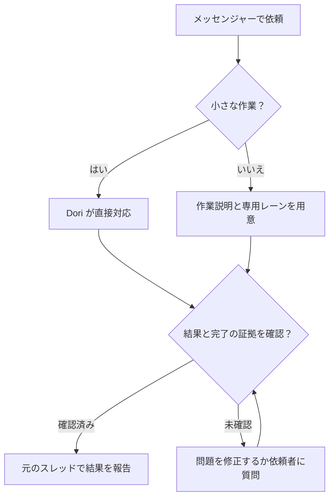

# omp-dori

三つのプロジェクトの思想を組み合わせ、一つの Dori にまとめています。

1. [dori-superagent](https://github.com/sisyphuslabs/dori-superagent) — メッセンジャーを窓口にした依頼への責任と、証拠に基づく作業の連携。
2. [oh-my-pi](https://github.com/can1357/oh-my-pi) — ネイティブのコーディングエージェントランタイムとツール群。
3. [omp-ulw](https://github.com/dbc-hbin/omp-ulw) — 成果を軸に進める、規律あるワークフロー。

omp-dori は、メッセンジャーでの依頼を担当が明確なコーディングエージェントの作業レーンに変え、完了の証拠とともに報告する、OMP を基に改変した移植版です。

[English](README.md) | [한국어](README.ko.md) | [日本語](README.ja.md) | [Deutsch](README.de.md) | [Italiano](README.it.md) | [中文](README.zh.md)

## できること

- 長い作業には専用のブリーフ、エージェントセッション、追跡対象のレーンを用意し、小さな依頼はリードが直接処理します。
- 会話の窓口を一つに保ちます。レーンはリードに報告し、リードが依頼元のスレッドで返信します。
- 配信前に、稼働中のエージェントの識別情報、入力欄、承認状態を確認し、セッションが作業中または状態不明ならメッセージを保留またはキューに入れます。
- 完了の証拠を必須とし、マージ済み PR、公開済みバージョン、正常終了したコマンド、条件に一致するファイルなど、完了シグナルの現在の状態を確認します。
- 作業ログ、レーンのチェックポイント、レジストリをディスクに保存し、再起動後に `dori boot` で確認できます。
- 教訓やバックログを保持し、任意の毎時スケジューリングと、ホストの状態や作業の停滞を監視する機能で継続的な作業を支えます。

## 依頼から完了まで

## サポート対象のプレビュー

**`v0.1.2` は Linux x64 + herdr + Discord 向けの GitHub プレリリースです。** Bun **1.4.4** とネイティブ OMP **18.18.8** が、検証済みの基準かつ最低バージョンです。新しいバージョンやほかの Linux ディストリビューションが自動的に検証済みとなるわけではありません。

macOS と hc は CI の対象で、ソース内にアダプターも残っていますが、サポート対象の実運用向け利用者プレビューには含まれません。Slack と Telegram はソース版の機能です。この範囲は、独立した外部ユーザーによるベータテストの実施や、すべてのプロバイダーと利用環境の検証を意味しません。

## 使い始めるには

1. git、Bun 1.4.4+、ネイティブ OMP 18.18.8+、herdr を `PATH` に置きます。インストーラーはこれらのツールを確認するだけで、インストールやアップグレードは行いません。
2. [検証済みの正確なリリースの導入手順](docs/releases.md#install-the-exact-preview)に従います。正規のリポジトリとタグ、および四つすべてのアセットを検証してから、明示的な `--version v0.1.2` を指定してダウンロード済みのインストーラーを実行してください。ランチャーは `~/.dori/bin/dori` です。`~/.dori/bin` を `PATH` に追加します。
3. 自分の `~/.dori/config.json` に `runtime: "herdr"`、ワークスペースのパス、プロバイダー名付きのモデル、メッセンジャーフックを設定します。既存の設定、認証情報、作業、セッションは保持されます。自分の OMP プロバイダーアカウントと Discord ボットを使います。
4. [認証と明示的な起動](docs/releases.md#your-authentication-and-explicit-startup)に従い、herdr の OMP 連携をインストールし、ボットのチャンネル権限と Message Content Intent、所有者とチャンネルの ID を設定してから、herdr 内で `omp --dori-role dori` を起動し、「Dori mode」と伝えます。
5. [Discord の所有者メッセージ受信](docs/releases.md#discord-owner-intake)用のネイティブモニターを明示的に有効にします。トークンは自分が所有するパーミッション 0600 のファイルに保管し、モニターの子プロセス内でのみ読み込みます。`INBOUND_READY` を待ってから、所有者として新しいメッセージを送信します。[オンライン表示](docs/releases.md#discord-online-presence)には、別途有効化する専用のモニターが必要です。

インストール時には**何も起動しません**。エージェント、受信プロセス、ウォッチャー、オンライン表示用プロセス、サービス、ハーネス、推論リクエストのいずれも開始しません。既存の Dori セッションを再開すると、記録済みのモニターが復元される場合がありますが、新規インストールでは作成されません。

### 更新とロールバック

`dori update check --version v0.1.2`、`dori update install --version v0.1.2`、`dori update status`、`dori update rollback` を使います。稼働中の Dori が存在する間は、アイドル状態でも有効化は保留されます。停止してメンテナンスする時間を確保してください。ロールバックには、検証済みで保持されている以前のリリースが必要です。詳細は[更新方法と復旧](docs/releases.md#updates-and-rollback)を参照してください。

### 既存の Dori と併用するソース版のインストール

メンテナーは通常のチェックアウトを別に用意し、[ソース版のインストールガイド](docs/releases.md#source-checkouts-for-maintainers)に従って `scripts/install-source.sh` を使います。side モードは専用のホーム、ラッパー、スキルを持ち、メインの Dori インストールには触れません。利用者向けリリースが管理するホームは、ソースインストールから保護されます。インストール済みの利用者向けリリースは変更せず固定したままにしてください。

インストールされる `dori` はメッセンジャーとレーン用の CLI です。完全なハーネスは `dori harness <args>`、またはソースチェックアウト内での `bun src/cli.ts <args>` で利用できます。ハーネスを起動すると実際のセッションとループが作成され、そのレジストリと完了プロトコルはスキル側とは別です。メンテナーのソース更新には [`dori upstream`](skills/dori-mode/references/scripts.md#staged-dori-updates) を使い、利用者向けリリースの更新とは別に扱います。

## OMP session contract

リード・当番セッションは `omp --dori-role dori`、作業レーンと組み込みレビュアーは `--dori-role lane` を使います。Dori の拡張ハンドラーはロールで適用範囲を制御し、通常の OMP セッションには変更を加えません。再開後もロールは保持され、プロセスに結び付いたネイティブのセッション記録と承認記録によって入力配信を保護します。ネイティブの目標と記録済みのモニター実行設定はセッション状態に残り、所有元の Dori セッションを再開すると記録済みのモニターが復元されます。利用者向けリリースは、マニフェストに紐づく omp-ulw の固定バージョンとロール限定のインポートを保持します。ソース版の primary モードでは omp-ulw をグローバルに読み込めますが、side モードでは専用ラッパー内に限定します。詳細は[ランタイムの契約](docs/runtime.md)を参照してください。

## ドキュメント

- [リリース、インストール、サポート、更新とロールバック](docs/releases.md)
- [Dori スキルと運用ルール](skills/dori-mode/SKILL.md) · [セットアップリファレンス](skills/dori-mode/references/setup.md)
- [ランタイムアダプターとセッションの契約](docs/runtime.md)
- [メンテナー向けコンテナ構成](docs/container.md) · [毎時ループとバックログ](docs/hourly-loop.md)
- [貢献ガイド](CONTRIBUTING.md) · [変更履歴](CHANGELOG.md) · [修正版の告知](NOTICE)

## 貢献するには

omp-dori の [Issue](https://github.com/vntrevx/omp-dori/issues) と [プルリクエスト](https://github.com/vntrevx/omp-dori/pulls) は、このフォークに送ってください。[貢献ガイド](CONTRIBUTING.md)を参照してください。上流の CLA 手続きは別です。

## 制約とプライバシー

Dori は、利用者が提供するアカウントと権限で動作します。外部への操作には引き続き所有者の許可が必要です。完了チェックが証明するのは設定されたシグナルであり、すべての結果の正しさを保証するものではありません。実行するつもりのセッションとモニターだけを有効にしてください。AI セッションは自分のプロバイダーの利用枠を消費します。

任意のテレメトリーは `DORI_TELEMETRY=0` または `DO_NOT_TRACK=1` で無効にできます。認証情報や非公開のセッション・プロジェクトデータを公開レポートに含めないでください。

## ライセンス

上流コードには引き続き [Sustainable Use License 1.0](LICENSE) が適用されます。自社内での業務利用と非商用・個人利用が認められ、配布と表示の条件があります。既存の OMP 統合に関する表示は [LICENSE.omp-dori (MIT)](LICENSE.omp-dori) に残り、上流コードを MIT として再ライセンスするものではありません。[NOTICE](NOTICE) に、この修正版と出典の表示を記録しています。omp-ulw などのサードパーティ製コンポーネントには、それぞれのライセンスが適用されます。
