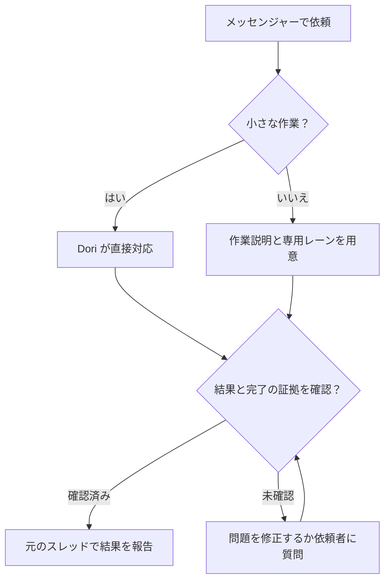

# omp-dori

三つのプロジェクトの思想を組み合わせ、一つの Dori にまとめています。

1. [dori-superagent](https://github.com/sisyphuslabs/dori-superagent) — メッセンジャーを窓口にした依頼への責任と、証拠に基づく作業の連携。
2. [oh-my-pi](https://github.com/can1357/oh-my-pi) — ネイティブのコーディングエージェントランタイムとツール群。
3. [omp-ulw](https://github.com/dbc-hbin/omp-ulw) — 成果を軸に進める、規律あるワークフロー。

omp-dori は、メッセンジャーでの依頼を担当が明確なコーディングエージェントの作業レーンに変え、完了の証拠とともに報告する、OMP を基に改変した移植版です。

[English](README.md) | [한국어](README.ko.md) | [日本語](README.ja.md) | [Deutsch](README.de.md) | [Italiano](README.it.md) | [中文](README.zh.md)

## できること

- 長い作業には専用のブリーフ、エージェントセッション、追跡対象のレーンを用意し、小さな依頼はリードが直接処理します。
- 会話の窓口を一つに保ちます。レーンはリードに報告し、リードが依頼元のスレッドで返信します。
- 配信前に、稼働中のエージェントの識別情報、入力欄、承認状態を確認し、セッションが作業中または状態不明ならメッセージを保留またはキューに入れます。
- 完了の証拠を必須とし、マージ済み PR、公開済みバージョン、正常終了したコマンド、条件に一致するファイルなど、完了シグナルの現在の状態を確認します。
- 作業ログ、レーンのチェックポイント、レジストリをディスクに保存し、再起動後に `dori boot` で確認できます。
- 教訓やバックログを保持し、任意の毎時スケジューリングと、ホストの状態や作業の停滞を監視する機能で継続的な作業を支えます。

## 依頼から完了まで



## サポート対象のプレビュー

**`v0.1.2` は Linux x64 + herdr + Discord 向けの GitHub プレリリースです。** Bun **1.4.4** とネイティブ OMP **18.18.8** が、検証済みの基準かつ最低バージョンです。新しいバージョンやほかの Linux ディストリビューションが自動的に検証済みとなるわけではありません。

macOS と hc は CI の対象で、ソースの `main` にアダプターもありますが、サポート対象の実運用向け利用者プレビューには含まれません。Slack と Telegram はソース版の機能です。この範囲は、独立した外部ユーザーによるベータテストの実施や、すべてのプロバイダーと利用環境の検証を意味しません。

## 使い始めるには

### 1. 前提条件とバージョンを確認

以下のコマンドは Linux x64 の Bash で実行します（`uname` の結果は `Linux` と `x86_64`）。git、[Bun](https://bun.sh) **1.4.4+**、[ネイティブ OMP](https://github.com/can1357/oh-my-pi) **18.18.8+**、[herdr](https://github.com/herdrdev/herdr) を、それぞれの導入手順に従って `PATH` に用意してください。Bash、curl、tar、`sha256sum` も必要です。Dori のインストーラーはツールを確認するだけで、インストールやアップグレードは行いません。

```bash
uname -s
uname -m
for tool in bash curl tar sha256sum git bun omp herdr; do
  command -v "$tool" || exit 1
done
git --version
bun --version
omp --version
```

### 2. v0.1.2 をダウンロード・検証・インストール

ダウンロード前に、[正規の v0.1.2 リリース](https://github.com/vntrevx/omp-dori/releases/tag/v0.1.2)でリポジトリの所有者、タグ、リリースのコミットを確認してください。[検証済みの正確なリリースの導入手順](docs/releases.md#install-the-exact-preview)に従って四つのアセットをそろえ、フォーク、`main` のインストーラー、ミラーで代用しないでください。初回インストールは自分のホームを使い、Dori が稼働していない状態で行います。既存のインストールがある場合は、ソースや状態を変更する前に確認してください。

```bash
download_dir="$(mktemp -d)" || exit 1
cd "$download_dir" || exit 1
release_url="https://github.com/vntrevx/omp-dori/releases/download/v0.1.2"
for asset in install.sh release-manifest.json SHA256SUMS omp-dori-v0.1.2.tar.gz; do
  curl --proto '=https' --tlsv1.2 -fL "$release_url/$asset" -o "$asset" || exit 1
done
sha256sum --check SHA256SUMS || exit 1
bash ./install.sh --version v0.1.2 --from "$download_dir" || exit 1
"$HOME/.dori/bin/dori" --version
export PATH="$HOME/.dori/bin:$PATH"
```

すべてのチェックサムが通ってからインストーラーを実行してください。チェックサムは信頼したリリースとの整合性を示すもので、独立した署名ではありません。インストーラーはマニフェスト、アーカイブ、固定された公開 omp-ulw 依存関係も検証します。`--from` を使っても、初回はその正確な依存関係を取得するため匿名 git のネットワーク接続が必要な場合があります。明示的なランチャーは `~/.dori/bin/dori` です。必要なら PATH の設定を自分のシェル設定に保存してください。GitHub CLI や GitHub への書き込み権限は不要です。

インストール時には**何も起動しません**。エージェント、受信プロセス、ウォッチャー、オンライン表示用プロセス、サービス、ハーネス、推論リクエストのいずれも開始しません。既存の Dori セッションを再開すると、記録済みのモニターが復元される場合がありますが、新規インストールでは作成されません。

### 3. 自分の環境を設定

[認証と明示的な起動](docs/releases.md#your-authentication-and-explicit-startup)に従い、herdr の OMP 連携を明示的にインストールします。

```bash
herdr integration install omp
```

一時ダウンロードディレクトリを離れ、作業するプロジェクトのディレクトリで herdr のターミナルを開き、ペイン ID を取得します。

```bash
herdr pane current
```

`~/.dori/config.json` を編集し、`runtime: "herdr"`、そのペイン ID を使う `leadPane`、`laneWorkspace`、`defaultCwd`、自分のアカウントで利用できるプロバイダー名付きの `defaultModel`、メッセンジャーフックを設定します。インストーラーが用意した `agentCommand`、`sessionsDir`、`ompUlwPath` は維持してください。既存の設定、認証情報、作業、セッションは保持されます。OMP の手順に従って自分のプロバイダーアカウントで認証してください。Dori にプロバイダーの認証情報は含まれません。

[Discord Developer Portal](https://discord.com/developers/applications)で自分のボットを作成・招待します。View Channel、Read Message History、Send Messages と使用するスレッド権限を付与し、Bot ページの **Message Content Intent** を有効にしてください。権限とメッセンジャーフックは[ボット設定リファレンス](skills/dori-mode/references/setup.md#3-bot)を参照してください。[トークンファイルの手順](docs/releases.md#your-authentication-and-explicit-startup)に従い、トークンだけを自分が所有する通常ファイル `~/.dori/discord-token` にモード `0600` で保存します。明示的に有効にしたモニターの子プロセスだけが `DORI_DISCORD_TOKEN` として読み込みます。チャット、ソース、コマンド引数、親 OMP の環境には値を入れないでください。

### 4. 最初の OMP ロールセッションを明示的に起動

Discord Developer Mode を有効にし、自分のユーザー ID と正確なチャンネル ID、またはスレッド自体の ID をコピーします。これらは秘密情報ではない正の十進数字列です。同じ herdr ターミナルで Bash の対話入力を使います。

```bash
read -r -p "Your Discord user ID: " DORI_DISCORD_OWNER_ID
read -r -p "Discord channel or thread ID: " DORI_DISCORD_CHANNEL_ID
export DORI_DISCORD_OWNER_ID DORI_DISCORD_CHANNEL_ID
omp --dori-role dori
```

続いて「Dori mode」と伝え、名前、メッセンジャーの送信先、許可するツールの初期設定を完了します。この操作は AI セッションを明示的に開始し、自分のプロバイダーの利用枠を消費します。

### 5. Discord モニターを選んで起動

所有元の OMP セッションで、[Discord の所有者メッセージ受信の手順](docs/releases.md#discord-owner-intake)にある、保護されたトークンファイルを読む子プロセスの `argv` とフィルター `^INBOUND` を使い、ネイティブ `monitor` を明示的に起動します。上で設定した二つの非秘密 ID を継承します。`INBOUND_READY` を待ってから所有者として新しいメッセージを送信してください。初回は過去のメッセージを再生せず、基準点を記録します。[オンライン表示](docs/releases.md#discord-online-presence)には別途有効化するネイティブモニターが必要です。インストールだけでは、プロバイダー認証やメッセンジャーの送受信を証明しません。

### 更新とロールバック

`dori update check --version v0.1.2`、`dori update install --version v0.1.2`、`dori update status`、`dori update rollback` を使います。稼働中の Dori が存在する間は、アイドル状態でも有効化は保留されます。停止してメンテナンスする時間を確保してください。ロールバックには、検証済みで保持されている以前のリリースが必要です。詳細は[更新方法と復旧](docs/releases.md#updates-and-rollback)を参照してください。

### 既存の Dori と併用するソース版のインストール

メンテナーは通常のチェックアウトを別に用意し、[ソース版のインストールガイド](docs/releases.md#source-checkouts-for-maintainers)に従って `scripts/install-source.sh` を使います。side モードは専用のホーム、ラッパー、スキルを持ち、メインの Dori インストールには触れません。利用者向けリリースが管理するホームは、ソースインストールから保護されます。インストール済みの利用者向けリリースは変更せず固定したままにしてください。

これは利用者向けプレビューと分かれた、任意のソース `main` の導入経路です。以下のチェックアウト先が未使用の場合に実行してください。

```bash
git clone https://github.com/vntrevx/omp-dori.git "$HOME/src/omp-dori" || exit 1
cd "$HOME/src/omp-dori" || exit 1
DORI_INSTALL_MODE=side DORI_NO_PULL=1 DORI_SRC="$PWD" bash scripts/install-source.sh
```

`DORI_NO_PULL=1` は選んだチェックアウトをそのままインストールします。side モードの既定の設定は `~/.omp-dori/config.json` で、専用の状態とラッパーを使います。`OMP_DORI_BIN_DIR`（既定 `${BUN_INSTALL:-$HOME/.bun}/bin`）には `omp-dori` だけをリンクします。そのホームには `omp-dori <command>` と `omp-dori omp ...` を使い、生成された `stateDir` と `agentCommand` を維持してください。別のボット、チャンネル、ランタイム名前空間を使います。この任意のインストールはセッションやモニターを起動せず、メインの `~/.dori`、`dori` コマンド、グローバルなスキルと拡張のリンクを維持します。

インストールされる `dori` はメッセンジャーとレーン用の CLI です。完全なハーネスは `dori harness <args>`、またはソースチェックアウト内での `bun src/cli.ts <args>` で利用できます。ハーネスを起動すると実際のセッションとループが作成され、そのレジストリと完了プロトコルはスキル側とは別です。メンテナーのソース更新には [`dori upstream`](skills/dori-mode/references/scripts.md#staged-dori-updates) を使い、利用者向けリリースの更新とは別に扱います。

## OMP session contract

リード・当番セッションは `omp --dori-role dori`、作業レーンと組み込みレビュアーは `--dori-role lane` を使います。Dori の拡張ハンドラーはロールで適用範囲を制御し、通常の OMP セッションには変更を加えません。再開後もロールは保持され、プロセスに結び付いたネイティブのセッション記録と承認記録によって入力配信を保護します。ネイティブの目標と記録済みのモニター実行設定はセッション状態に残り、所有元の Dori セッションを再開すると記録済みのモニターが復元されます。利用者向けリリースは、マニフェストに紐づく omp-ulw の固定バージョンとロール限定のインポートを保持します。ソース版の primary モードでは omp-ulw をグローバルに読み込めますが、side モードでは専用ラッパー内に限定します。詳細は[ランタイムの契約](docs/runtime.md)を参照してください。

## ドキュメント

- [リリース、インストール、サポート、更新とロールバック](docs/releases.md)
- [Dori スキルと運用ルール](skills/dori-mode/SKILL.md) · [セットアップリファレンス](skills/dori-mode/references/setup.md)
- [ランタイムアダプターとセッションの契約](docs/runtime.md)
- [メンテナー向けコンテナ構成](docs/container.md) · [毎時ループとバックログ](docs/hourly-loop.md)
- [貢献ガイド](CONTRIBUTING.md) · [変更履歴](CHANGELOG.md) · [修正版の告知](NOTICE)

## 貢献するには

omp-dori の [Issue](https://github.com/vntrevx/omp-dori/issues) と [プルリクエスト](https://github.com/vntrevx/omp-dori/pulls) は、このフォークに送ってください。[貢献ガイド](CONTRIBUTING.md)を参照してください。上流の CLA 手続きは別です。

## 制約とプライバシー

Dori は、利用者が提供するアカウントと権限で動作します。外部への操作には引き続き所有者の許可が必要です。完了チェックが証明するのは設定されたシグナルであり、すべての結果の正しさを保証するものではありません。実行するつもりのセッションとモニターだけを有効にしてください。AI セッションは自分のプロバイダーの利用枠を消費します。

任意のテレメトリーは `DORI_TELEMETRY=0` または `DO_NOT_TRACK=1` で無効にできます。認証情報や非公開のセッション・プロジェクトデータを公開レポートに含めないでください。

## ライセンス

上流コードには引き続き [Sustainable Use License 1.0](LICENSE) が適用されます。自社内での業務利用と非商用・個人利用が認められ、配布と表示の条件があります。既存の OMP 統合に関する表示は [LICENSE.omp-dori (MIT)](LICENSE.omp-dori) に残り、上流コードを MIT として再ライセンスするものではありません。[NOTICE](NOTICE) に、この修正版と出典の表示を記録しています。omp-ulw などのサードパーティ製コンポーネントには、それぞれのライセンスが適用されます。
