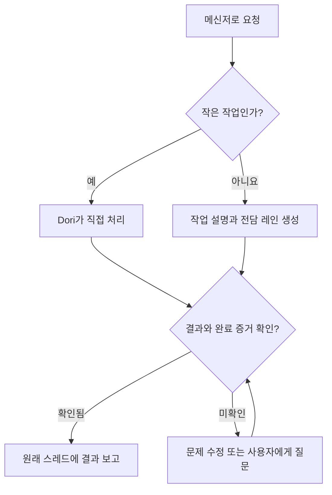

# omp-dori

세 프로젝트의 철학을 하나의 Dori로 합쳤습니다.

1. [dori-superagent](https://github.com/sisyphuslabs/dori-superagent) — 메신저에서 요청을 받아 끝까지 책임지고, 증거를 바탕으로 작업을 조율합니다.
2. [oh-my-pi](https://github.com/can1357/oh-my-pi) — native 코딩 에이전트 런타임과 도구를 제공합니다.
3. [omp-ulw](https://github.com/dbc-hbin/omp-ulw) — 결과를 중심으로 규율 있게 실행하는 워크플로를 더합니다.

omp-dori는 메신저 요청을 담당 코딩 에이전트 레인에 맡기고 완료 증거와 함께 보고하는 수정 OMP 포트입니다.

[English](README.md) | [한국어](README.ko.md) | [日本語](README.ja.md) | [Deutsch](README.de.md) | [Italiano](README.it.md) | [中文](README.zh.md)

## 주요 기능

- 긴 작업마다 brief, 에이전트 세션과 추적 레인을 만들고, 작은 요청은 lead가 직접 처리합니다.
- 레인은 lead에게 보고하고 lead가 요청 스레드에 답해 대화 창구를 하나로 유지합니다.
- Discord owner 메시지의 답장 맥락과 첨부 메타데이터를 받으며, 서명된 미디어 URL과 제공된 음성 길이를 전달합니다.
- 전달 전에 살아 있는 에이전트의 신원·입력·승인 상태를 확인하고, 바쁘거나 상태가 불명확한 세션에는 전송을 보류하거나 대기열에 넣습니다.
- 완료 증거를 요구하고 PR merge, 버전 발행, 명령 성공, 파일 일치 등 지정한 완료 신호를 실제 상태와 대조합니다.
- worklog, 레인 checkpoint와 레지스트리를 디스크에 남겨 재시작 후 `dori boot`로 점검합니다.
- lessons, backlog, 선택적 시간 단위 스케줄링과 호스트·정체 감시로 지속적인 작업을 지원합니다.

## 요청이 완료될 때까지

## 지원하는 preview

**`v0.1.2`는 Linux x64 + herdr + Discord용 GitHub prerelease입니다.** Bun **1.4.4**와 native OMP **18.18.8**은 테스트 기준이자 최소 버전입니다. 더 높은 버전과 다른 Linux 배포판이 자동으로 검증되는 것은 아닙니다.

macOS와 hc는 CI 범위와 소스 어댑터를 유지하며 실제 소비자 preview 지원 대상에서는 제외됩니다. Slack과 Telegram은 소스 기능으로 남아 있습니다. 이 지원 범위가 독립 외부 사용자 beta 완료나 모든 provider·기능의 검증을 뜻하지는 않습니다.

## 시작하기

1. git, Bun 1.4.4+, native OMP 18.18.8+, herdr를 `PATH`에 준비하세요. 설치기는 이 도구들을 점검하며 설치·업그레이드는 하지 않습니다.
2. [정확한 릴리스 설치·검증 절차](docs/releases.md#install-the-exact-preview)를 따르세요. canonical 저장소·태그와 네 asset을 검증한 뒤 내려받은 설치기에 `--version v0.1.2`를 명시합니다. 실행 경로는 `~/.dori/bin/dori`이며 `~/.dori/bin`을 `PATH`에 추가하세요.
3. 본인의 `~/.dori/config.json`에 `runtime: "herdr"`, 작업 경로, provider가 포함된 모델과 메신저 hook을 설정하세요. 기존 설정·인증·작업·세션은 보존됩니다. 본인의 OMP provider 계정과 Discord 봇을 사용합니다.
4. [인증과 명시적 시작](docs/releases.md#your-authentication-and-explicit-startup)에 따라 herdr의 OMP integration, 봇 채널 권한과 Message Content Intent, owner·channel ID를 설정하세요. herdr에서 `omp --dori-role dori`를 실행한 뒤 “Dori mode”라고 말합니다.
5. [Discord owner 수신](docs/releases.md#discord-owner-intake)용 native monitor를 명시적으로 켜세요. 토큰은 본인 소유 mode-0600 파일에 두고 monitor 자식 프로세스에서만 읽습니다. `INBOUND_READY` 후 새 owner 메시지를 보내세요. [Online presence](docs/releases.md#discord-online-presence)는 별도 monitor를 켜야 합니다.

설치는 에이전트·수신기·watcher·presence 프로세스·service·harness·추론 요청을 **시작하지 않습니다**. 기존 Dori 세션을 재개하면 그 세션에 기록된 monitor가 복원될 수 있으며, 새 설치는 monitor를 만들지 않습니다.

### 업데이트와 rollback

`dori update check --version v0.1.2`, `dori update install --version v0.1.2`, `dori update status`, `dori update rollback`을 사용합니다. 살아 있는 Dori가 있으면 idle이어도 활성화가 보류되므로 세션을 종료한 유지보수 시간을 계획하세요. Rollback에는 검증된 직전 릴리스가 보존되어 있어야 합니다. [업데이트 옵션과 복구](docs/releases.md#updates-and-rollback)를 확인하세요.

### 기존 Dori 옆에 소스 설치

Maintainer는 별도의 일반 checkout과 `scripts/install-source.sh`를 사용하며 [소스 설치 가이드](docs/releases.md#source-checkouts-for-maintainers)를 따릅니다. Side 모드는 별도 home·wrapper·skill을 사용해 primary Dori 설치를 그대로 둡니다. 소비자 관리 home은 소스 설치로부터 보호됩니다. 설치된 소비자 릴리스 파일은 직접 수정하지 마세요.

설치되는 `dori`는 메신저·레인 CLI입니다. 전체 harness는 `dori harness <args>`로, 소스 checkout에서는 `bun src/cli.ts <args>`로도 실행합니다. Harness 시작은 실제 세션과 loop를 만들며 레지스트리·완료 프로토콜은 skill과 별개입니다. Maintainer 소스 업데이트는 소비자 릴리스 업데이트와 구분되는 [`dori upstream`](skills/dori-mode/references/scripts.md#staged-dori-updates)을 사용합니다.

## OMP session contract

Lead·duty는 `omp --dori-role dori`, 작업 레인과 기본 reviewer는 `--dori-role lane`을 사용합니다. Dori 확장 handler는 역할로 제한되며 일반 OMP 세션의 동작을 유지합니다. 역할은 재개 시 복원되고 살아 있는 프로세스에 연결된 native 세션·승인 기록으로 입력 전달을 보호합니다. Native goal과 monitor 실행 의도는 세션 상태에 남으며, 소유 Dori 세션을 재개하면 기록된 monitor가 복원됩니다. 소비자 릴리스는 manifest에 묶인 omp-ulw pin과 역할별 import를 유지합니다. 소스 primary 모드는 omp-ulw를 전역으로 로드할 수 있고 side 모드는 wrapper 안에서만 로드합니다. [Runtime 계약](docs/runtime.md)을 확인하세요.

## 문서

- [릴리스·설치·지원·업데이트·rollback](docs/releases.md)
- [Dori skill과 운영 규칙](skills/dori-mode/SKILL.md) · [설정 상세](skills/dori-mode/references/setup.md)
- [Runtime 어댑터와 세션 계약](docs/runtime.md)
- [Maintainer container 예제](docs/container.md) · [시간 단위 loop와 backlog](docs/hourly-loop.md)
- [기여 안내](CONTRIBUTING.md) · [변경 기록](CHANGELOG.md) · [수정본 고지](NOTICE)

## 기여하기

omp-dori의 [issue](https://github.com/vntrevx/omp-dori/issues)와 [PR](https://github.com/vntrevx/omp-dori/pulls)은 이 fork에 제출하고 [기여 안내](CONTRIBUTING.md)를 따라 주세요. Upstream CLA 절차는 별개입니다.

## 한계·개인정보

Dori는 사용자가 제공한 계정과 권한으로 실행합니다. 외부 변경에는 여전히 소유자의 승인이 필요하며 완료 검사는 설정한 신호를 입증하는 절차입니다. 모든 결과의 정확성을 보장하지는 않습니다. 운영할 세션과 monitor만 켜세요. AI 세션은 본인 provider의 사용량을 소비합니다.

선택적 telemetry는 `DORI_TELEMETRY=0` 또는 `DO_NOT_TRACK=1`로 끕니다. 공개 보고에 인증 정보나 비공개 세션·프로젝트 데이터를 넣지 마세요.

## 라이선스

Upstream 코드는 [Sustainable Use License 1.0](LICENSE)을 유지합니다. 자체 내부 업무와 비상업·개인 이용을 허용하며 배포·고지 조건이 적용됩니다. 기존 OMP 통합 고지는 [LICENSE.omp-dori (MIT)](LICENSE.omp-dori)에 남으며 upstream 코드를 MIT로 바꾸는 것은 아닙니다. [NOTICE](NOTICE)에 수정본과 출처를 기록합니다. omp-ulw와 다른 제3자 구성 요소는 각각의 라이선스를 유지합니다.
