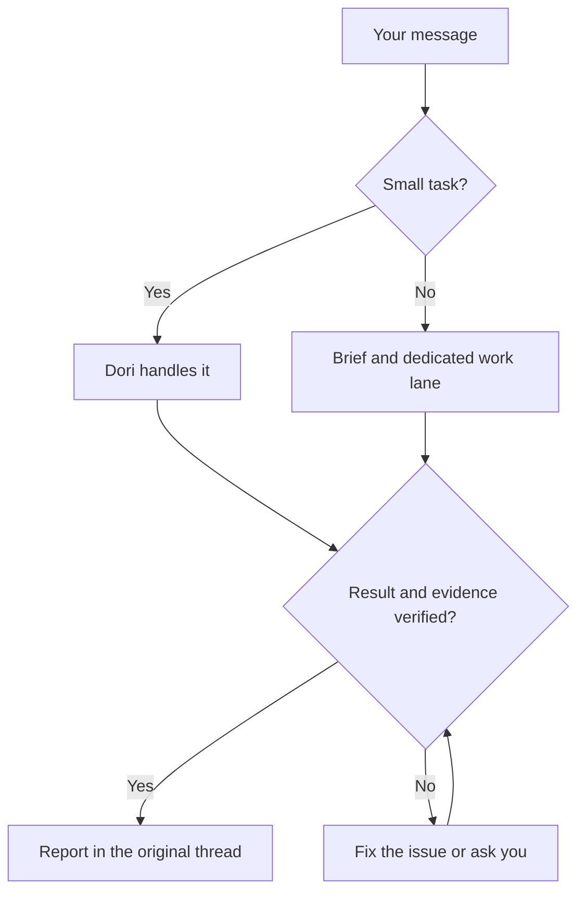

# omp-dori

One Dori, combining three projects' philosophies:

1. [dori-superagent](https://github.com/sisyphuslabs/dori-superagent) — messenger-facing ownership and evidence-based coordination.
2. [oh-my-pi](https://github.com/can1357/oh-my-pi) — a native coding-agent runtime and tooling.
3. [omp-ulw](https://github.com/dbc-hbin/omp-ulw) — disciplined, outcome-driven workflows.

omp-dori is a modified OMP port that turns messenger requests into owned coding-agent work lanes and reports back with completion evidence.

[English](README.md) | [한국어](README.ko.md) | [日本語](README.ja.md) | [Deutsch](README.de.md) | [Italiano](README.it.md) | [中文](README.zh.md)

## What it does

- Gives longer jobs their own brief, agent session and tracked lane; the lead handles small requests directly.
- Keeps one voice in the conversation: lanes report to the lead, who replies in the request's thread.
- Checks live agent identity, input and approval state before delivery; holds or queues messages when a session is busy or its state is unknown.
- Requires completion evidence and checks live done signals, such as merged PRs, published versions, passing commands or matching files.
- Saves worklogs, lane checkpoints and registries on disk so `dori boot` can inspect them after a restart.
- Retains lessons, a backlog, optional hourly scheduling and host/stall supervision for ongoing work.

## How a request becomes finished work

## Supported preview

**`v0.1.2` is a GitHub prerelease for Linux x64 + herdr + Discord.** Bun **1.4.4** and native OMP **18.18.8** are the tested baseline and minimum versions. Newer versions and other Linux distributions are not automatically verified.

macOS and hc have CI coverage and retained source adapters; they are outside the supported live consumer preview. Slack and Telegram remain source features. This scope does not imply an independent external-user beta or that every provider and surface has been tested.

## Getting started

1. Put git, Bun 1.4.4+, native OMP 18.18.8+ and herdr on `PATH`. The installer checks these tools; it never installs or upgrades them.
2. Follow the [verified exact-release walkthrough](docs/releases.md#install-the-exact-preview). Verify the canonical repository/tag and all four assets before running the downloaded installer with explicit `--version v0.1.2`. The launcher is `~/.dori/bin/dori`; add `~/.dori/bin` to `PATH`.
3. Configure your own `~/.dori/config.json` with `runtime: "herdr"`, workspace paths, a provider-qualified model and messenger hooks. Existing config, authentication, work and sessions are preserved. Use your own OMP provider account and Discord bot.
4. Follow [authentication and explicit startup](docs/releases.md#your-authentication-and-explicit-startup): install herdr's OMP integration, configure the bot's channel permissions and Message Content Intent, set the owner/channel IDs, then start `omp --dori-role dori` in herdr and say “Dori mode”.
5. Explicitly enable the native monitor for [Discord owner intake](docs/releases.md#discord-owner-intake). Keep the token in an owned mode-0600 file and read it only in the monitor child. Wait for `INBOUND_READY`, then send a fresh owner message. [Online presence](docs/releases.md#discord-online-presence) needs its own separately enabled monitor.

Installation starts **nothing**: no agent, receiver, watcher, presence process, service, harness or inference request. Resuming an existing Dori session can restore its recorded monitors; a fresh installation creates none.

### Updates and rollback

Use `dori update check --version v0.1.2`, `dori update install --version v0.1.2`, `dori update status` and `dori update rollback`. Activation holds while a live Dori exists, including an idle one; plan a stopped maintenance window. Rollback requires a verified retained previous release. See [update options and recovery](docs/releases.md#updates-and-rollback).

### Source installation next to an existing Dori

Maintainers use a separate ordinary checkout and `scripts/install-source.sh`, following the [source installation guide](docs/releases.md#source-checkouts-for-maintainers). Side mode keeps its own home, wrappers and skill; it leaves the primary Dori installation alone. Consumer-managed homes are protected from source installation. Keep installed consumer releases frozen.

The installed `dori` is the messenger/lane CLI. The complete harness remains available through `dori harness <args>` or `bun src/cli.ts <args>` from a source checkout. Harness startup creates real sessions and loops; its registry and completion protocol are separate from the skill's. Maintainer source updates use [`dori upstream`](skills/dori-mode/references/scripts.md#staged-dori-updates), separately from consumer release updates.

## OMP session contract

Lead/duty sessions use `omp --dori-role dori`; work lanes and the built-in reviewer use `--dori-role lane`. Dori's extension handlers are role-gated, leaving ordinary OMP sessions unchanged. Roles persist across resume, and process-bound native session/approval records guard input delivery. Native goals and recorded monitor intent survive through session state; resuming the owning Dori session restores its recorded monitors. Consumer releases retain their manifest-bound omp-ulw pin and role-scoped import. Source primary mode can load omp-ulw globally, while side mode confines it to its wrapper. See the [runtime contract](docs/runtime.md).

## Documentation

- [Releases, installation, support, updates and rollback](docs/releases.md)
- [Dori skill and operating rules](skills/dori-mode/SKILL.md) · [Setup reference](skills/dori-mode/references/setup.md)
- [Runtime adapters and session contracts](docs/runtime.md)
- [Maintainer container recipe](docs/container.md) · [Hourly loop and backlog](docs/hourly-loop.md)
- [Contributing](CONTRIBUTING.md) · [Changelog](CHANGELOG.md) · [Modified-copy notice](NOTICE)

## Contributing

Open omp-dori [issues](https://github.com/vntrevx/omp-dori/issues) and [pull requests](https://github.com/vntrevx/omp-dori/pulls) in this fork. Follow the [contribution guide](CONTRIBUTING.md); the upstream CLA process is separate.

## Limits and privacy

Dori runs with the accounts and permissions you supply. External effects still need the owner's authorization; completion checks prove their configured signals, not correctness of every result. Enable only the sessions and monitors you intend to run. AI sessions use your own provider quota.

Optional telemetry can be disabled with `DORI_TELEMETRY=0` or `DO_NOT_TRACK=1`. Keep credentials and private session/project data out of public reports.

## License

Upstream code remains under the [Sustainable Use License 1.0](LICENSE): own internal business use and non-commercial/personal use, with distribution and notice conditions. The pre-existing OMP integration notice remains in [LICENSE.omp-dori (MIT)](LICENSE.omp-dori); this does not relicense upstream code as MIT. [NOTICE](NOTICE) records the modified copy and attribution. omp-ulw and other third-party components retain their own licenses.
