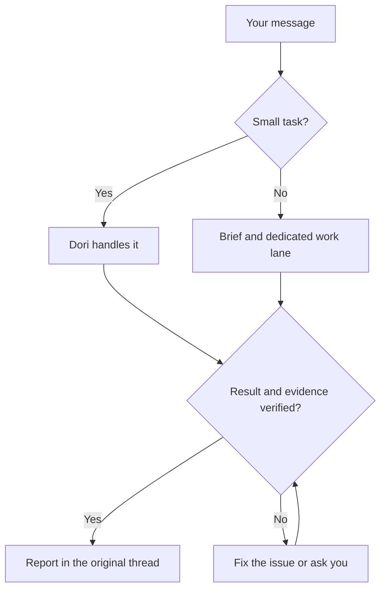

# omp-dori

One Dori, combining three projects' philosophies:

1. [dori-superagent](https://github.com/sisyphuslabs/dori-superagent) — messenger-facing ownership and evidence-based coordination.
2. [oh-my-pi](https://github.com/can1357/oh-my-pi) — a native coding-agent runtime and tooling.
3. [omp-ulw](https://github.com/dbc-hbin/omp-ulw) — disciplined, outcome-driven workflows.

omp-dori is a modified OMP port that turns messenger requests into owned coding-agent work lanes and reports back with completion evidence.

[English](README.md) | [한국어](README.ko.md) | [日本語](README.ja.md) | [Deutsch](README.de.md) | [Italiano](README.it.md) | [中文](README.zh.md)

## What it does

- Gives longer jobs their own brief, agent session and tracked lane; the lead handles small requests directly.
- Keeps one voice in the conversation: lanes report to the lead, who replies in the request's thread.
- Receives owner Discord messages with reply context and attachment metadata, including signed media URLs and voice duration when available.
- Checks live agent identity, input and approval state before delivery; holds or queues messages when a session is busy or its state is unknown.
- Requires completion evidence and checks live done signals, such as merged PRs, published versions, passing commands or matching files.
- Saves worklogs, lane checkpoints and registries on disk so `dori boot` can inspect them after a restart.
- Retains lessons, a backlog, optional hourly scheduling and host/stall supervision for ongoing work.

## How a request becomes finished work



## Supported preview

**`v0.1.2` is a GitHub prerelease for Linux x64 + herdr + Discord.** Bun **1.4.4** and native OMP **18.18.8** are the tested baseline and minimum versions. Newer versions and other Linux distributions are not automatically verified.

macOS and hc have CI coverage and adapters on source `main`; they are outside the supported live consumer preview. Slack and Telegram remain source features. This scope does not imply an independent external-user beta or that every provider and surface has been tested.

## Getting started

### 1. Check prerequisites

Run the following commands in Bash on Linux x64 (`uname` should report `Linux` and `x86_64`). Put git, [Bun](https://bun.sh) **1.4.4+**, [native OMP](https://github.com/can1357/oh-my-pi) **18.18.8+** and [herdr](https://github.com/herdrdev/herdr) on `PATH` using their own installation instructions. Bash, curl, tar and `sha256sum` are also required. The Dori installer checks the toolchain; it never installs or upgrades it.

```bash
uname -s
uname -m
for tool in bash curl tar sha256sum git bun omp herdr; do
  command -v "$tool" || exit 1
done
git --version
bun --version
omp --version
```

### 2. Download, verify and install v0.1.2

Check the repository owner, tag and release commit on the [canonical v0.1.2 release](https://github.com/vntrevx/omp-dori/releases/tag/v0.1.2) before downloading its four assets. Follow the [verified exact-release walkthrough](docs/releases.md#install-the-exact-preview); do not substitute a fork, a `main` installer or a mirror. For a first install, use your own home with no running Dori. Inspect any existing installation before changing its source or state.

```bash
download_dir="$(mktemp -d)" || exit 1
cd "$download_dir" || exit 1
release_url="https://github.com/vntrevx/omp-dori/releases/download/v0.1.2"
for asset in install.sh release-manifest.json SHA256SUMS omp-dori-v0.1.2.tar.gz; do
  curl --proto '=https' --tlsv1.2 -fL "$release_url/$asset" -o "$asset" || exit 1
done
sha256sum --check SHA256SUMS || exit 1
bash ./install.sh --version v0.1.2 --from "$download_dir" || exit 1
"$HOME/.dori/bin/dori" --version
export PATH="$HOME/.dori/bin:$PATH"
```

Run the installer only after every checksum passes. Checksums establish consistency with the trusted release, not an independent signature; the installer also verifies the manifest, archive and pinned public omp-ulw dependency. `--from` can still need anonymous git access for that exact dependency on first install. The explicit launcher is `~/.dori/bin/dori`; retain the PATH export in your shell configuration if desired. GitHub CLI and GitHub write access are not required.

Installation starts **nothing**: no agent, receiver, watcher, presence process, service, harness or inference request. Resuming an existing Dori session can restore its recorded monitors; a fresh installation creates none.

### 3. Configure your own environment

Follow [authentication and explicit startup](docs/releases.md#your-authentication-and-explicit-startup). Install herdr's OMP integration explicitly:

```bash
herdr integration install omp
```

Open a herdr terminal in your intended project directory, outside the temporary download directory, and obtain its pane ID:

```bash
herdr pane current
```

Edit `~/.dori/config.json`: set `runtime: "herdr"`, `leadPane` to that pane ID, `laneWorkspace`, `defaultCwd`, a provider-qualified `defaultModel` available to your account and messenger hooks. Keep the installer's `agentCommand`, `sessionsDir` and `ompUlwPath`. Existing config, authentication, work and sessions are preserved. Authenticate OMP with your own provider account using OMP's instructions; no provider credentials ship with Dori.

Create and invite your own bot through the [Discord Developer Portal](https://discord.com/developers/applications). Grant View Channel and Read Message History, plus Send Messages and the thread permissions you will use; enable **Message Content Intent** on the Bot page. The [bot setup reference](skills/dori-mode/references/setup.md#3-bot) covers permissions and messenger hooks. Store the token alone in an owned regular `~/.dori/discord-token` file with mode `0600`, following the [protected token-file instructions](docs/releases.md#your-authentication-and-explicit-startup). Only the opted-in monitor child reads it as `DORI_DISCORD_TOKEN`; keep it out of chat, source, command arguments and the parent OMP environment.

### 4. Start the first OMP role explicitly

Enable Discord Developer Mode and copy your own user ID and exact channel ID, or the thread's own ID. These are non-secret positive decimal strings. In the same herdr terminal, use Bash's interactive prompts:

```bash
read -r -p "Your Discord user ID: " DORI_DISCORD_OWNER_ID
read -r -p "Discord channel or thread ID: " DORI_DISCORD_CHANNEL_ID
export DORI_DISCORD_OWNER_ID DORI_DISCORD_CHANNEL_ID
omp --dori-role dori
```

Then say “Dori mode” and complete the name, messenger destination and permitted-tool onboarding. This explicitly starts an AI session and uses your own provider quota.

### 5. Opt in to Discord monitors

In the owning OMP session, explicitly start the native `monitor` with the protected-token child `argv` and filter `^INBOUND` from the [Discord owner intake recipe](docs/releases.md#discord-owner-intake). It inherits the two non-secret IDs above. Wait for `INBOUND_READY`, then send a fresh owner message; the first start records a baseline without replaying old messages. [Online presence](docs/releases.md#discord-online-presence) needs its own separately enabled native monitor. Installation alone proves neither provider authentication nor messenger delivery.

### Updates and rollback

Use `dori update check --version v0.1.2`, `dori update install --version v0.1.2`, `dori update status` and `dori update rollback`. Activation holds while a live Dori exists, including an idle one; plan a stopped maintenance window. Rollback requires a verified retained previous release. See [update options and recovery](docs/releases.md#updates-and-rollback).

### Source installation next to an existing Dori

Maintainers use a separate ordinary checkout and `scripts/install-source.sh`, following the [source installation guide](docs/releases.md#source-checkouts-for-maintainers). Side mode keeps its own home, wrappers and skill; it leaves the primary Dori installation alone. Consumer-managed homes are protected from source installation. Keep installed consumer releases frozen.

This is an optional source `main` path, separate from the consumer preview. With the documented destination unused, run:

```bash
git clone https://github.com/vntrevx/omp-dori.git "$HOME/src/omp-dori" || exit 1
cd "$HOME/src/omp-dori" || exit 1
DORI_INSTALL_MODE=side DORI_NO_PULL=1 DORI_SRC="$PWD" bash scripts/install-source.sh
```

`DORI_NO_PULL=1` installs the selected checkout as it is. Side mode defaults to `~/.omp-dori/config.json` and its own state/wrappers; only `omp-dori` is linked in `OMP_DORI_BIN_DIR` (default `${BUN_INSTALL:-$HOME/.bun}/bin`). Use `omp-dori <command>` and `omp-dori omp ...` for that home, keep its generated `stateDir` and `agentCommand`, and use a separate bot/channel and runtime namespace. This opt-in installation starts no sessions or monitors and leaves the primary `~/.dori`, `dori` command and global skill/extension links alone.

The installed `dori` is the messenger/lane CLI. The complete harness remains available through `dori harness <args>` or `bun src/cli.ts <args>` from a source checkout. Harness startup creates real sessions and loops; its registry and completion protocol are separate from the skill's. Maintainer source updates use [`dori upstream`](skills/dori-mode/references/scripts.md#staged-dori-updates), separately from consumer release updates.

## OMP session contract

Lead/duty sessions use `omp --dori-role dori`; work lanes and the built-in reviewer use `--dori-role lane`. Dori's extension handlers are role-gated, leaving ordinary OMP sessions unchanged. Roles persist across resume, and process-bound native session/approval records guard input delivery. Native goals and recorded monitor intent survive through session state; resuming the owning Dori session restores its recorded monitors. Consumer releases retain their manifest-bound omp-ulw pin and role-scoped import. Source primary mode can load omp-ulw globally, while side mode confines it to its wrapper. See the [runtime contract](docs/runtime.md).

## Documentation

- [Releases, installation, support, updates and rollback](docs/releases.md)
- [Dori skill and operating rules](skills/dori-mode/SKILL.md) · [Setup reference](skills/dori-mode/references/setup.md)
- [Runtime adapters and session contracts](docs/runtime.md)
- [Maintainer container recipe](docs/container.md) · [Hourly loop and backlog](docs/hourly-loop.md)
- [Contributing](CONTRIBUTING.md) · [Changelog](CHANGELOG.md) · [Modified-copy notice](NOTICE)

## Contributing

Open omp-dori [issues](https://github.com/vntrevx/omp-dori/issues) and [pull requests](https://github.com/vntrevx/omp-dori/pulls) in this fork. Follow the [contribution guide](CONTRIBUTING.md); the upstream CLA process is separate.

## Limits and privacy

Dori runs with the accounts and permissions you supply. External effects still need the owner's authorization; completion checks prove their configured signals, not correctness of every result. Enable only the sessions and monitors you intend to run. AI sessions use your own provider quota.

Optional telemetry can be disabled with `DORI_TELEMETRY=0` or `DO_NOT_TRACK=1`. Keep credentials and private session/project data out of public reports.

## License

Upstream code remains under the [Sustainable Use License 1.0](LICENSE): own internal business use and non-commercial/personal use, with distribution and notice conditions. The pre-existing OMP integration notice remains in [LICENSE.omp-dori (MIT)](LICENSE.omp-dori); this does not relicense upstream code as MIT. [NOTICE](NOTICE) records the modified copy and attribution. omp-ulw and other third-party components retain their own licenses.
