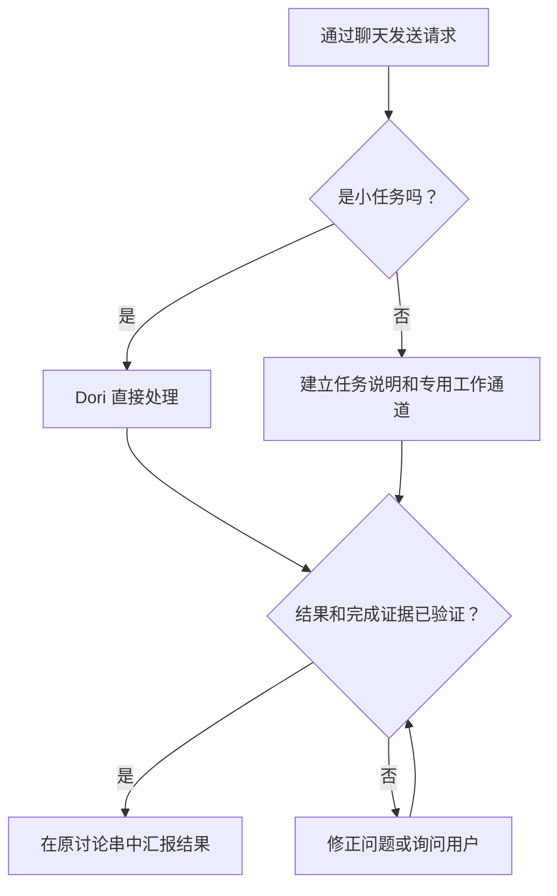

# omp-dori

一个 Dori，融合三个项目的理念：

1. [dori-superagent](https://github.com/sisyphuslabs/dori-superagent) — 通过聊天工具承接并负责各项任务，以证据协调工作。
2. [oh-my-pi](https://github.com/can1357/oh-my-pi) — 原生编程代理运行时与工具。
3. [omp-ulw](https://github.com/dbc-hbin/omp-ulw) — 严谨、以成果为导向的工作流。

omp-dori 是经修改的 OMP 移植版，可将聊天工具中的请求转为有明确负责方的编程代理工作通道（lane），并附上完成证据进行汇报。

[English](README.md) | [한국어](README.ko.md) | [日本語](README.ja.md) | [Deutsch](README.de.md) | [Italiano](README.it.md) | [中文](README.zh.md)

## 功能概览

- 为耗时较长的任务建立专属任务说明、代理会话和可跟踪的通道；小请求由主会话直接处理。
- 保持统一的对话出口：各通道向主会话汇报，由主会话在原请求的讨论串中回复。
- 投递前检查运行中代理的身份、输入栏和审批状态；会话忙碌或状态未知时，暂存消息或将其加入队列。
- 要求提供完成证据，并检查当前的完成信号，例如已合并的 PR、已发布的版本、成功执行的命令或符合条件的文件。
- 将工作日志、通道检查点和注册表保存在磁盘上，供 `dori boot` 在重启后检查。
- 保留经验和待办队列，提供可选的每小时调度，以及主机状态和任务停滞监控，以支持持续工作。

## 从请求到完成



## 受支持的预览版

**`v0.1.2` 是面向 Linux x64 + herdr + Discord 的 GitHub 预发行版。** Bun **1.4.4** 和原生 OMP **18.18.8** 是经过测试的基准，也是最低版本要求。更新的版本和其他 Linux 发行版并不自动视为已验证。

macOS 和 hc 有 CI 覆盖，源码 `main` 中也保留了适配器，但不属于受支持的用户预览版实际运行环境。Slack 和 Telegram 仍是源码版功能。这一范围并不表示已开展独立的外部用户 beta 测试，也不表示所有提供商和使用界面都已完成验证。

## 入门

### 1. 检查前置工具和版本

以下命令在 Linux x64 的 Bash 中执行（`uname` 应显示 `Linux` 和 `x86_64`）。按照各项目自己的安装说明，将 git、[Bun](https://bun.sh) **1.4.4+**、[原生 OMP](https://github.com/can1357/oh-my-pi) **18.18.8+** 和 [herdr](https://github.com/herdrdev/herdr) 加入 `PATH`。还需要 Bash、curl、tar 和 `sha256sum`。Dori 安装器会检查工具，但不会安装或升级它们。

```bash
uname -s
uname -m
for tool in bash curl tar sha256sum git bun omp herdr; do
  command -v "$tool" || exit 1
done
git --version
bun --version
omp --version
```

### 2. 下载、验证并安装 v0.1.2

下载前，请在[正式 v0.1.2 发布页](https://github.com/vntrevx/omp-dori/releases/tag/v0.1.2)核验仓库所有者、标签和发布 commit。按照[已验证的精确版本安装步骤](docs/releases.md#install-the-exact-preview)下载全部四个资源文件，请勿用 fork、`main` 安装器或镜像替换。首次安装使用自己的 home，且没有正在运行的 Dori。若已有安装，请先检查，再更改其源码或状态。

```bash
download_dir="$(mktemp -d)" || exit 1
cd "$download_dir" || exit 1
release_url="https://github.com/vntrevx/omp-dori/releases/download/v0.1.2"
for asset in install.sh release-manifest.json SHA256SUMS omp-dori-v0.1.2.tar.gz; do
  curl --proto '=https' --tlsv1.2 -fL "$release_url/$asset" -o "$asset" || exit 1
done
sha256sum --check SHA256SUMS || exit 1
bash ./install.sh --version v0.1.2 --from "$download_dir" || exit 1
"$HOME/.dori/bin/dori" --version
export PATH="$HOME/.dori/bin:$PATH"
```

所有校验和通过后才运行安装器。校验和证明文件与所信任发布的一致性，并非独立签名；安装器还会验证 manifest、archive 和固定的公开 omp-ulw 依赖。即使使用 `--from`，首次安装仍可能需要通过匿名 git 网络访问获取该精确依赖。明确的启动路径是 `~/.dori/bin/dori`；可按需将 PATH 设置保存在自己的 shell 配置中。无需 GitHub CLI 或 GitHub 写权限。

安装**不会启动任何东西**：代理、接收进程、监视进程、在线状态进程、服务、调度框架或推理请求均不会启动。恢复既有 Dori 会话时，可能会恢复其记录的监控器；全新安装不会创建监控器。

### 3. 配置自己的环境

按照[认证与手动启动](docs/releases.md#your-authentication-and-explicit-startup)，显式安装 herdr 的 OMP 集成：

```bash
herdr integration install omp
```

离开临时下载目录，在实际工作的项目目录中打开 herdr 终端，并获取其 pane ID：

```bash
herdr pane current
```

编辑 `~/.dori/config.json`：设置 `runtime: "herdr"`，将 `leadPane` 设为该 pane ID，并设置 `laneWorkspace`、`defaultCwd`、自己账号可用且带提供商标识的 `defaultModel` 和聊天工具 hook。保留安装器生成的 `agentCommand`、`sessionsDir` 和 `ompUlwPath`。既有配置、认证信息、工作和会话均会保留。按照 OMP 的说明使用自己的提供商账号认证；Dori 不附带提供商凭据。

通过 [Discord Developer Portal](https://discord.com/developers/applications)创建并邀请自己的机器人。授予 View Channel、Read Message History、Send Messages 以及要使用的 thread 权限，并在 Bot 页面启用 **Message Content Intent**。[机器人设置参考](skills/dori-mode/references/setup.md#3-bot)说明权限和聊天工具 hook。按照[受保护令牌文件说明](docs/releases.md#your-authentication-and-explicit-startup)，仅将令牌保存在自己拥有的普通文件 `~/.dori/discord-token` 中，权限为 `0600`。只有显式启用的监控器子进程才将其读取为 `DORI_DISCORD_TOKEN`；请勿将令牌值放入聊天、源码、命令参数或父 OMP 环境。

### 4. 显式启动第一个 OMP 角色会话

启用 Discord Developer Mode，复制自己的用户 ID 和准确的频道 ID，或 thread 自身的 ID。这些是非秘密的正十进制字符串。在同一个 herdr 终端中使用 Bash 交互输入：

```bash
read -r -p "Your Discord user ID: " DORI_DISCORD_OWNER_ID
read -r -p "Discord channel or thread ID: " DORI_DISCORD_CHANNEL_ID
export DORI_DISCORD_OWNER_ID DORI_DISCORD_CHANNEL_ID
omp --dori-role dori
```

然后说“Dori mode”，完成名称、聊天目的地和允许工具的 onboarding。这一步会显式启动 AI 会话，并消耗自己的提供商配额。

### 5. 按需启用 Discord 监控器

在所属 OMP 会话中，使用 [Discord 所有者消息接收示例](docs/releases.md#discord-owner-intake)中读取受保护令牌文件的子进程 `argv` 和过滤器 `^INBOUND`，显式启动原生 `monitor`。它会继承上面两个非秘密 ID。等待 `INBOUND_READY`，再以所有者身份发送一条新消息；首次启动仅记录基准点，不重放旧消息。[在线状态](docs/releases.md#discord-online-presence)需要另行启用的独立原生监控器。仅安装成功并不证明提供商认证或聊天消息投递已完成。

### 更新与回滚

使用 `dori update check --version v0.1.2`、`dori update install --version v0.1.2`、`dori update status` 和 `dori update rollback`。只要仍有正在运行的 Dori，即使处于空闲状态，激活也会暂缓；请安排停止运行后的维护时段。回滚需要经过验证且仍保留的上一版本。详见[更新选项与恢复](docs/releases.md#updates-and-rollback)。

### 与现有 Dori 并存的源码安装

维护者使用独立的普通检出目录，按[源码安装指南](docs/releases.md#source-checkouts-for-maintainers)运行 `scripts/install-source.sh`。side 模式使用独立的主目录、包装脚本和技能，不影响主 Dori 安装。用户发行版管理的主目录受到保护，防止源码安装写入。已安装的用户发行版请保持冻结，不作修改。

这是与用户预览版分开的可选源码 `main` 安装路径。以下文档指定的 checkout 目标路径尚未使用时，可执行：

```bash
git clone https://github.com/vntrevx/omp-dori.git "$HOME/src/omp-dori" || exit 1
cd "$HOME/src/omp-dori" || exit 1
DORI_INSTALL_MODE=side DORI_NO_PULL=1 DORI_SRC="$PWD" bash scripts/install-source.sh
```

`DORI_NO_PULL=1` 会按原样安装所选 checkout。side 模式默认使用 `~/.omp-dori/config.json` 及独立的状态和 wrapper；只在 `OMP_DORI_BIN_DIR`（默认 `${BUN_INSTALL:-$HOME/.bun}/bin`）中链接 `omp-dori`。使用 `omp-dori <command>` 和 `omp-dori omp ...` 操作该 home，保留生成的 `stateDir` 和 `agentCommand`，并使用独立的机器人、频道和 runtime namespace。这一可选安装不会启动会话或监控器，并保持主 `~/.dori`、`dori` 命令及全局 skill、extension 链接不变。

安装后的 `dori` 是聊天与通道管理 CLI。完整调度框架仍可通过 `dori harness <args>`，或在源码检出目录中通过 `bun src/cli.ts <args>` 使用。启动调度框架会创建真实会话和循环，并使用与技能侧相互独立的注册表和完成协议。维护者通过 [`dori upstream`](skills/dori-mode/references/scripts.md#staged-dori-updates)更新源码，与用户发行版更新分开处理。

## OMP session contract

主会话和当值会话使用 `omp --dori-role dori`；工作通道和内置审查器使用 `--dori-role lane`。Dori 扩展处理器按角色启用，普通 OMP 会话保持不变。角色会在会话恢复后保留，绑定进程的原生会话与审批记录会保护输入投递。原生目标及已记录的监控器运行意图通过会话状态持久保存；恢复所属的 Dori 会话时，会恢复其记录的监控器。用户发行版保留与清单绑定的 omp-ulw 固定版本及按角色限定的导入。源码版 primary 模式可全局加载 omp-ulw，而 side 模式将其限制在自己的包装脚本中。详见[运行时约定](docs/runtime.md)。

## 文档

- [发布、安装、支持、更新和回滚](docs/releases.md)
- [Dori 技能与操作规则](skills/dori-mode/SKILL.md) · [设置参考](skills/dori-mode/references/setup.md)
- [运行时适配器与会话约定](docs/runtime.md)
- [维护者容器构建指南](docs/container.md) · [每小时循环与待办队列](docs/hourly-loop.md)
- [贡献指南](CONTRIBUTING.md) · [变更日志](CHANGELOG.md) · [修改副本声明](NOTICE)

## 参与贡献

请在此 fork 提交 omp-dori 的 [issue](https://github.com/vntrevx/omp-dori/issues) 和 [PR](https://github.com/vntrevx/omp-dori/pulls)，并参阅[贡献指南](CONTRIBUTING.md)。上游 CLA 流程仅适用于上游项目。

## 限制与隐私

Dori 使用你提供的账号和权限运行。对外部系统的操作仍需所有者授权；完成检查只证明配置的信号已满足，并不保证每项结果都正确。请仅启用你打算运行的会话和监控器。AI 会话消耗你自己的提供商配额。

可选遥测可通过 `DORI_TELEMETRY=0` 或 `DO_NOT_TRACK=1` 关闭。公开报告中请勿包含凭据或私有会话、项目数据。

## 许可证

上游代码仍适用 [Sustainable Use License 1.0](LICENSE)：允许自身内部业务用途及非商业、个人用途，并附有分发和声明保留条件。既有 OMP 集成声明保留在 [LICENSE.omp-dori (MIT)](LICENSE.omp-dori) 中；这并未将上游代码重新许可为 MIT。[NOTICE](NOTICE) 记录了修改副本和来源署名。omp-ulw 及其他第三方组件保留各自的许可证。
